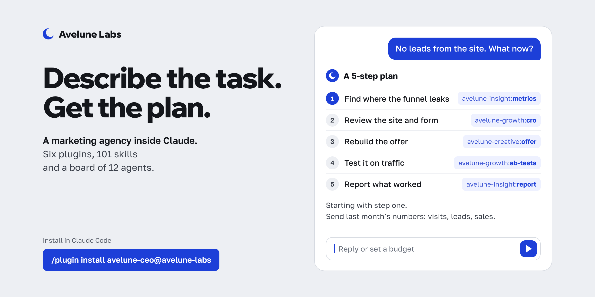

<p align="center"><picture><source media="(prefers-color-scheme: dark)" srcset="assets/banner-en-dark.png"></picture></p>

<p align="center">


</p>

<p align="center"><a href="README.md">Русский</a> · <b>English</b></p>

<p align="center"><i>For a coffee shop or a clinic, an online school or a factory, a local business or B2B.</i></p>

---

## What it is

**Avelune Labs** is a set of six Claude Code plugins that work as one team: a CEO, a creative director, an SMM lead, a growth marketer, an analyst and an advertising lawyer. Inside are 101 skills, a 12-agent board of directors and supervision of every agent the coordinator launches.

Describe the task in plain words, such as “run our promotion for November” or “we get leads but no sales”. Claude picks the skills, runs the steps in order and checks the result.

> The skills are written in Russian and tuned for the Russian market (VK, Telegram, Yandex, 2GIS, Russian advertising and data law). Claude reads them in any language, and the methods and campaign references are universal.

## How it differs from just asking an AI

| Typical AI answer | With Avelune Labs |
|-------------------|-------------------|
| “Create engaging content” | A content plan with rubrics, hooks and dates, plus a CSV for any scheduler |
| “Our unique product is a game changer” | Banned clichés, a concrete detail instead of an adjective, an editor pass |
| Numbers “according to studies” | Source and date checked; without data, an explicit “Assumption:” and a quick way to test it |
| Advice that ignores the law | Ad marking, advertising law, personal data law, the 2026 Russian-language rule |
| One point of view | 12 independent board agents and an honest verdict: unanimous or not |
| Average-of-the-market creative | 33 reference campaigns, from Volkswagen “Think Small” to T-Bank |

<p align="center"></p>

## Plugins

<table><tr><td width="50%" valign="top">&nbsp;<a href="plugins/avelune-ceo/README.md"><b>CEO</b></a><br>&nbsp;<code>avelune-ceo</code> · 22 skills<br clear="left"><sub>Strategy, unit economics, pricing, hiring, negotiation. A 12-agent board, agent supervision and a conductor for all plugins.</sub></td><td width="50%" valign="top">&nbsp;<a href="plugins/avelune-creative/README.md"><b>Creative</b></a><br>&nbsp;<code>avelune-creative</code> · 20 skills<br clear="left"><sub>Big ideas, offers, hooks, headlines, landing pages, scripts, naming, slogans, brand voice, cliché-free editing.</sub></td></tr><tr><td width="50%" valign="top">&nbsp;<a href="plugins/avelune-smm/README.md"><b>SMM</b></a><br>&nbsp;<code>avelune-smm</code> · 20 skills<br clear="left"><sub>Content plans, newsjacking calendar, audits, community, negativity, influencers, Telegram, VK, Dzen, video, live.</sub></td><td width="50%" valign="top">&nbsp;<a href="plugins/avelune-growth/README.md"><b>Growth & Sales</b></a><br>&nbsp;<code>avelune-growth</code> · 20 skills<br clear="left"><sub>Market research, positioning, VK Ads, Yandex Direct, funnels, bots, launches, sales scripts, objections, retention, reviews, promos.</sub></td></tr><tr><td width="50%" valign="top">&nbsp;<a href="plugins/avelune-insight/README.md"><b>Insight & SEO</b></a><br>&nbsp;<code>avelune-insight</code> · 12 skills<br clear="left"><sub>Metrics, reports, forecasts, surveys, trends, mentions, SEO for AI answers, keyword research, maps.</sub></td><td width="50%" valign="top">&nbsp;<a href="plugins/avelune-shield/README.md"><b>Shield</b></a><br>&nbsp;<code>avelune-shield</code> · 7 skills<br clear="left"><sub>Russian ad marking, advertising and language law, platform rules, contracts, personal data, crisis, knowledge base.</sub></td></tr></table>

## Quick start

You need [Claude Code](https://code.claude.com/docs/en/overview).

```text
/plugin marketplace add angelmaycrv/avelune-labs
/plugin install avelune-ceo@avelune-labs
/plugin install avelune-creative@avelune-labs
/plugin install avelune-smm@avelune-labs
/plugin install avelune-growth@avelune-labs
/plugin install avelune-insight@avelune-labs
/plugin install avelune-shield@avelune-labs
```

Install only what you need, for example just Creative and SMM. For a local clone: `/plugin marketplace add ./avelune-labs`.

The same from a regular terminal, without an open Claude Code session:

```bash
claude plugin marketplace add angelmaycrv/avelune-labs
claude plugin install avelune-ceo@avelune-labs
```

To update: `claude plugin marketplace update avelune-labs`, then `claude plugin update avelune-ceo@avelune-labs` and restart Claude Code. To remove a plugin: `claude plugin uninstall avelune-ceo@avelune-labs`.

Then describe a task:

```text
Run the dental clinic’s promotion for November, budget 150,000 rubles
```

The `avelune-ceo:avelune` conductor splits it into steps: metrics, maps, reviews, Yandex Direct, a content plan, a receptionist script and a report two weeks later. You can also call any skill directly, such as `/avelune-creative:offer` or `/avelune-insight:seo-audit`.

## Board and agent supervision

**Board.** `avelune-ceo:board` runs 12 agents: CFO, CMO, CPO, sales, operations, CTO, data, legal, brand, voice of the customer, risk and an independent director. Each one reviews the decision separately without seeing the others, and the verdict shows whether it is unanimous, who disagrees and why.

**Supervision.** Hooks in the CEO plugin remind the coordinator, at session start and after every agent run, that the agent’s result is not yet checked. The `avelune-ceo:supervisor` skill sets the routine: a brief with acceptance criteria before the run, a check against the brief after it, and a correction with specific points when the work drifts.

## Built on

- **Books and research:** Rackham, Dixon and Adamson, Voss, Cialdini, Byron Sharp, April Dunford, Ogilvy, Kahneman, Tetlock, Kaushik, Croll and Yoskovitz, Reichheld, Fitzpatrick, Coombs, Nielsen Norman Group and others.
- **Campaigns:** 33 references with agency, year, insight and mechanics.
- **Platform and legal facts:** each with a source and a check date (November 2026), logged in [`docs/research-notes.md`](docs/research-notes.md).

## Full skill catalog

<details>
<summary><b>CEO</b> · <code>avelune-ceo</code> · 22</summary>

| Skill | What it does (in Russian) |
|---|---|
| [`avelune-ceo:avelune`](plugins/avelune-ceo/skills/avelune/SKILL.md) | Дирижёр всех плагинов Avelune Labs. Принимает большую задачу одной фразой («запусти продвижение на месяц», «нет заявок», «открываем вторую точку», «запускаем курс»), разбивает её на шаги, выбирает нужные скиллы из шести плагинов, задаёт порядок, передаёт… |
| [`avelune-ceo:board`](plugins/avelune-ceo/skills/board/SKILL.md) | Совет директоров из 12 агентов. Решение или идея рассматривается независимо финансами, маркетингом, продуктом, технологиями, продажами, юристом, операциями, данными, брендом, голосом клиента, риск-менеджером и инвестором-стратегом. |
| [`avelune-ceo:brainstorm`](plugins/avelune-ceo/skills/brainstorm/SKILL.md) | Мозговой штурм по любой задаче: 30–50 идей разными техниками (SCAMPER, обратный штурм, морфологический ящик, аналогии, ограничения) и отбор лучших по ICE. |
| [`avelune-ceo:delegation`](plugins/avelune-ceo/skills/delegation/SKILL.md) | Превращает задачу в понятное техническое задание для сотрудника, подрядчика, фрилансера или ИИ-агента: цель, результат, критерии приёмки, сроки, бюджет, примеры. |
| [`avelune-ceo:finmodel`](plugins/avelune-ceo/skills/finmodel/SKILL.md) | Финансовая модель на 12 месяцев: выручка, расходы, прибыль, движение денег, точка безубыточности, три сценария и предупреждение о кассовом разрыве. |
| [`avelune-ceo:focus-week`](plugins/avelune-ceo/skills/focus-week/SKILL.md) | Планирование недели руководителя: разбор всех дел, приоритеты по важности и влиянию, что делегировать, что выбросить, блоки глубокой работы в календаре. |
| [`avelune-ceo:grants`](plugins/avelune-ceo/skills/grants/SKILL.md) | Поиск и подготовка заявок на гранты, субсидии, акселераторы и конкурсы для малого бизнеса, IT-проектов, социальных и культурных проектов в России. |
| [`avelune-ceo:hiring`](plugins/avelune-ceo/skills/hiring/SKILL.md) | Найм сотрудника или подрядчика: карта роли с результатами, текст вакансии, структурированное интервью, тестовое задание, проверка рекомендаций, шкала оценки. |
| [`avelune-ceo:meeting-notes`](plugins/avelune-ceo/skills/meeting-notes/SKILL.md) | Протокол встречи из заметок, расшифровки или записи: решения, задачи с владельцами и сроками, открытые вопросы, письмо участникам. |
| [`avelune-ceo:negotiation`](plugins/avelune-ceo/skills/negotiation/SKILL.md) | Подготовка к переговорам и ведение их: цели, лучшая альтернатива (BATNA), зона согласия, якорь, уступки, калиброванные вопросы, фразы для трудных моментов. |
| [`avelune-ceo:onboarding`](plugins/avelune-ceo/skills/onboarding/SKILL.md) | План ввода нового сотрудника или подрядчика в работу: первый день, первая неделя, 30-60-90 дней, доступы, наставник, первая победа. |
| [`avelune-ceo:partner-letters`](plugins/avelune-ceo/skills/partner-letters/SKILL.md) | Письма и сообщения партнёрам, блогерам, СМИ, поставщикам и клиентам: холодное письмо, предложение о сотрудничестве, напоминание без ответа, ответ на предложение, отказ, благодарность. |
| [`avelune-ceo:pitch`](plugins/avelune-ceo/skills/pitch/SKILL.md) | Питч и презентация для инвестора, акселератора, конкурса, партнёра или крупного клиента: структура из 10–12 слайдов, текст каждого слайда, ключевые цифры, речь на 3 и 10 минут, ответы на трудные вопросы. |
| [`avelune-ceo:playbooks`](plugins/avelune-ceo/skills/playbooks/SKILL.md) | Регламенты, инструкции и чек-листы, чтобы работа шла одинаково хорошо без постоянного участия руководителя. |
| [`avelune-ceo:postmortem`](plugins/avelune-ceo/skills/postmortem/SKILL.md) | Разбор неудачи без поиска виноватых: что случилось, почему, что меняем, чтобы не повторилось. |
| [`avelune-ceo:pricing`](plugins/avelune-ceo/skills/pricing/SKILL.md) | Цены и тарифы. Определяет цену через ценность для клиента, строит линейку тарифов, планирует повышение цены без потери клиентов, пишет текст анонса. |
| [`avelune-ceo:proposal`](plugins/avelune-ceo/skills/proposal/SKILL.md) | Коммерческое предложение под конкретного клиента: проблема клиента, решение, результат в цифрах, пакеты и цены, доказательства, следующий шаг. |
| [`avelune-ceo:risk-map`](plugins/avelune-ceo/skills/risk-map/SKILL.md) | Карта рисков бизнеса или проекта: что может пойти не так, вероятность и ущерб, ранние сигналы, план Б и страховка. |
| [`avelune-ceo:strategy-okr`](plugins/avelune-ceo/skills/strategy-okr/SKILL.md) | Стратегия и цели на квартал или год. Ставит диагноз, выбирает главное направление, превращает его в OKR и дорожную карту, отсекает лишнее. |
| [`avelune-ceo:supervisor`](plugins/avelune-ceo/skills/supervisor/SKILL.md) | Режим надзора координатора за агентами. Координатор ставит агентам задачи с критериями приёмки, следит за всеми работающими агентами, проверяет каждый результат по брифу и сразу поправляет агента, если он ушёл в сторону, выдумал факт или сделал не по формату. |
| [`avelune-ceo:unit-economics`](plugins/avelune-ceo/skills/unit-economics/SKILL.md) | Юнит-экономика бизнеса и каналов. Считает CAC, LTV, маржу, срок окупаемости клиента, отток, вклад каналов и показывает, какой рычаг исправит экономику. |
| [`avelune-ceo:weekly-brief`](plugins/avelune-ceo/skills/weekly-brief/SKILL.md) | Еженедельная сводка для руководителя на одну страницу: цифры против плана, победы, пожары, решения, которые нужны от руководителя. |

</details>

<details>
<summary><b>Creative</b> · <code>avelune-creative</code> · 20</summary>

| Skill | What it does (in Russian) |
|---|---|
| [`avelune-creative:brand-story`](plugins/avelune-creative/skills/brand-story/SKILL.md) | История бренда и основателя. Находит правдивый сюжет компании и упаковывает его для страницы «О нас», выступления, интервью, питча, серии постов. |
| [`avelune-creative:brand-voice`](plugins/avelune-creative/skills/brand-voice/SKILL.md) | Голос бренда. Создаёт гайд по тону: характер бренда, шкалы тона, тон по ситуациям, словарь «говорим / не говорим», правила обращения, эмодзи и пунктуации, примеры «было / стало». |
| [`avelune-creative:case-studies`](plugins/avelune-creative/skills/case-studies/SKILL.md) | Кейсы клиентов. Готовит вопросы для интервью с клиентом, вытаскивает историю «было → сделали → стало» с цифрами и цитатами, пишет кейс в нужном формате: статья, пост, карусель, видео, слайд для продаж. |
| [`avelune-creative:cover-text`](plugins/avelune-creative/skills/cover-text/SKILL.md) | Тексты и идеи обложек (превью) для YouTube, Rutube, VK Видео, Дзена, Reels, Shorts, TikTok и каруселей. |
| [`avelune-creative:creative-director`](plugins/avelune-creative/skills/creative-director/SKILL.md) | Креативный директор. Ищет инсайт и большую идею для кампании или запуска, чтобы о бренде заговорили, разворачивает её в ролик, наружку, соцсети, PR и спецпроект. |
| [`avelune-creative:creative-review`](plugins/avelune-creative/skills/creative-review/SKILL.md) | Проверка креатива перед публикацией. Оценивает пост, ролик, баннер, сценарий или рекламу по 12 критериям (заметность, понятность, одна мысль, неожиданность, доверие, эмоция, связь с брендом, призыв, площадка, закон, желание поделиться), ставит баллы, называет… |
| [`avelune-creative:director`](plugins/avelune-creative/skills/director/SKILL.md) | Режиссёр и оператор. Превращает идею в ролик, который можно снять: концепция, раскадровка по секундам, планы, ракурсы, движение камеры, свет, звук, монтаж, съёмка на телефон, промпты для ИИ-видео. |
| [`avelune-creative:editor`](plugins/avelune-creative/skills/editor/SKILL.md) | Редактор. Сокращает, упрощает и оживляет текст: убирает канцелярит, штампы, воду, признаки текста от ИИ, выстраивает структуру, проверяет факты, орфографию и типографику. |
| [`avelune-creative:headlines`](plugins/avelune-creative/skills/headlines/SKILL.md) | Заголовки для статей, лендингов, писем, рекламы, превью и постов. |
| [`avelune-creative:hooks`](plugins/avelune-creative/skills/hooks/SKILL.md) | Хуки, то есть первые 1–3 секунды ролика или первая строка текста, которые останавливают прокрутку. |
| [`avelune-creative:landing-copy`](plugins/avelune-creative/skills/landing-copy/SKILL.md) | Текст продающего лендинга или страницы продукта по блокам: первый экран, проблема, решение, как работает, доказательства, цены, возражения, призыв. |
| [`avelune-creative:memes-trends`](plugins/avelune-creative/skills/memes-trends/SKILL.md) | Мемы, тренды и ситуативный маркетинг. Оценивает, стоит ли бренду подхватывать мем, тренд или новость, находит связь с продуктом, пишет 3–5 вариантов поста или ролика, проверяет риски (стоп-темы, права на картинки, закон). |
| [`avelune-creative:naming`](plugins/avelune-creative/skills/naming/SKILL.md) | Нейминг. Придумывает названия для компании, продукта, тарифа, рубрики, акции, события: 50–100 вариантов разных типов, отбор по тестам SMILE и SCRATCH, проверка домена, товарного знака в ФИПС, звучания на других языках. |
| [`avelune-creative:offer`](plugins/avelune-creative/skills/offer/SKILL.md) | Оффер, то есть предложение, от которого трудно отказаться: что получает клиент, за сколько, почему сейчас, почему без риска. |
| [`avelune-creative:platform-copy`](plugins/avelune-creative/skills/platform-copy/SKILL.md) | Копирайтер под площадки. Один смысл превращается в готовые тексты для VK, Telegram, Дзена, YouTube, Rutube, VK Видео, TikTok, Reels, Shorts, Max, сайта и рассылки с учётом лимитов, культуры и кликабельности ссылок каждой площадки. |
| [`avelune-creative:reels-script`](plugins/avelune-creative/skills/reels-script/SKILL.md) | Сценарий короткого вертикального ролика (Reels, Shorts, TikTok, VK Клипы) на 7–60 секунд. |
| [`avelune-creative:repurpose`](plugins/avelune-creative/skills/repurpose/SKILL.md) | Перепаковка контента. Из одного большого материала (подкаст, эфир, вебинар, интервью, статья, выступление) делает 20+ единиц контента для разных площадок: клипы, карусели, посты, цитаты, статью, рассылку, чек-лист, и раскладывает их по календарю. |
| [`avelune-creative:rubrics`](plugins/avelune-creative/skills/rubrics/SKILL.md) | Рубрики для блога, канала или аккаунта бренда. |
| [`avelune-creative:slogans`](plugins/avelune-creative/skills/slogans/SKILL.md) | Слоганы и девизы бренда, подписи к логотипу, слоганы кампаний. |
| [`avelune-creative:storyteller`](plugins/avelune-creative/skills/storyteller/SKILL.md) | Сценарист. Придумывает свежие сюжеты, премисы и повороты, строит историю по битам и сценам, пишет диалоги, планирует серии роликов с героями. |

</details>

<details>
<summary><b>SMM</b> · <code>avelune-smm</code> · 20</summary>

| Skill | What it does (in Russian) |
|---|---|
| [`avelune-smm:account-audit`](plugins/avelune-smm/skills/account-audit/SKILL.md) | Аудит аккаунта или канала в Telegram, VK, YouTube, Rutube, Дзене, TikTok или Reels. |
| [`avelune-smm:collabs`](plugins/avelune-smm/skills/collabs/SKILL.md) | Коллаборации и кросс-маркетинг. Находит бренды-партнёры с той же аудиторией, придумывает формат (совместный продукт, событие, розыгрыш, контент, набор, взаимные рекомендации), пишет предложение партнёру и чек-лист договорённостей. |
| [`avelune-smm:community`](plugins/avelune-smm/skills/community/SKILL.md) | Комьюнити-менеджер. Отвечает на комментарии и сообщения в голосе бренда, разбирает поток из сотен комментариев по приоритетам, пишет шаблоны ответов на 15 типовых ситуаций, правила сообщества, матрицу эскалации и стандарты скорости ответа. |
| [`avelune-smm:content-plan`](plugins/avelune-smm/skills/content-plan/SKILL.md) | Контент-план на неделю, месяц или квартал под несколько площадок (Telegram, VK, Дзен, YouTube, Rutube, Reels, Shorts, TikTok, VK Клипы, сторис). |
| [`avelune-smm:crosspost`](plugins/avelune-smm/skills/crosspost/SKILL.md) | Адаптация одного контента под разные площадки (Telegram, VK, Дзен, YouTube, Rutube, VK Клипы, Shorts, Reels, TikTok, Одноклассники, сайт, рассылка): длина, формат, тон, обложки, подписи, хэштеги, призывы, время, ссылки с UTM, без водяных знаков чужих площадок. |
| [`avelune-smm:dzen`](plugins/avelune-smm/skills/dzen/SKILL.md) | Дзен для бизнеса и авторов. Как устроены рекомендации (охват не зависит от числа подписчиков), какие форматы сейчас получают просмотры (статьи, посты, ролики), темы, заголовки и обложки под ленту, перепаковка статей сайта, монетизация, план публикаций. |
| [`avelune-smm:faq-bot`](plugins/avelune-smm/skills/faq-bot/SKILL.md) | FAQ и чат-бот для ответов клиентам в Telegram, VK, на сайте или в мессенджере. |
| [`avelune-smm:giveaways`](plugins/avelune-smm/skills/giveaways/SKILL.md) | Конкурсы и розыгрыши в соцсетях. Подбирает механику под цель (охват, контент от клиентов, продажи, подписчики, которые останутся), пишет пост-анонс, официальные правила, тексты итогов, проверяет закон (конкурс или стимулирующая лотерея, НДФЛ с призов… |
| [`avelune-smm:influencers`](plugins/avelune-smm/skills/influencers/SKILL.md) | Работа с блогерами. Помогает найти и проверить блогеров (накрутки, аудитория, реестр РКН), посчитать CPM и цену результата, написать предложение о сотрудничестве, ТЗ на интеграцию, чек-лист договора и маркировки, оценить результат. |
| [`avelune-smm:live`](plugins/avelune-smm/skills/live/SKILL.md) | Прямые эфиры в VK, Telegram, YouTube, Rutube и других площадках. |
| [`avelune-smm:negativity`](plugins/avelune-smm/skills/negativity/SKILL.md) | Работа с негативом. Разбирает злой отзыв, жалобу, хейт, троллинг или фейк по дереву решений «отвечать или нет, где и как», пишет ответ, который успокаивает автора и убеждает читателей, подсказывает, когда эскалировать, оспаривать фейковый отзыв или звать… |
| [`avelune-smm:newsjacking-calendar`](plugins/avelune-smm/skills/newsjacking-calendar/SKILL.md) | Календарь инфоповодов. Подбирает праздники, профессиональные дни, сезонные и торговые события (Чёрная пятница, 11.11), памятные даты под нишу бизнеса на месяц, квартал или год, оценивает уместность, предлагает идеи постов и акций и сроки подготовки. |
| [`avelune-smm:profile-setup`](plugins/avelune-smm/skills/profile-setup/SKILL.md) | Оформление профиля, канала или сообщества в Telegram, VK, YouTube, Rutube, Дзене, TikTok и других площадках. |
| [`avelune-smm:short-video`](plugins/avelune-smm/skills/short-video/SKILL.md) | Стратегия коротких вертикальных видео (VK Клипы, YouTube Shorts, Reels, TikTok, Rutube Shorts, ролики Дзена). |
| [`avelune-smm:stories`](plugins/avelune-smm/skills/stories/SKILL.md) | Сторис (истории) в VK, Telegram и других площадках. |
| [`avelune-smm:telegram-growth`](plugins/avelune-smm/skills/telegram-growth/SKILL.md) | Рост и развитие Telegram-канала. Стратегия на 90 дней от позиционирования до продаж: ядро постов, оформление, источники подписчиков (свои клиенты, взаимопиар, папки, посевы, Telegram Ads, комментарии, кросс-промо), функции каналов (сторис и бусты, личные… |
| [`avelune-smm:tg-seeding`](plugins/avelune-smm/skills/tg-seeding/SKILL.md) | Посевы в Telegram и Telegram Ads. Подбирает и проверяет каналы для рекламы (накрутка, охват, реестр РКН), считает бюджет, CPM и цену подписчика, пишет 10 вариантов рекламных постов, готовит пригласительные ссылки для учёта, план теста и разбор результата. |
| [`avelune-smm:ugc`](plugins/avelune-smm/skills/ugc/SKILL.md) | Контент от клиентов (UGC). Как получать фото, видео, отзывы и истории клиентов: момент и форма просьбы, механики (хэштег, упаковка, конкурс, рубрика), работа с UGC-креаторами для рекламы, права и согласия на использование, где публиковать. |
| [`avelune-smm:video-platforms`](plugins/avelune-smm/skills/video-platforms/SKILL.md) | Длинные видео на Rutube, VK Видео и YouTube. |
| [`avelune-smm:vk-community`](plugins/avelune-smm/skills/vk-community/SKILL.md) | Сообщество ВКонтакте для бизнеса. Настройка (разделы, товары и услуги, кнопки, запись, отзывы, подтверждение бизнеса, виджеты, рассылки, чат-бот), контент под рекомендации (VK Клипы, VK Видео, посты, истории, эфиры), продажи прямо из сообщества, статистика. |

</details>

<details>
<summary><b>Growth & Sales</b> · <code>avelune-growth</code> · 20</summary>

| Skill | What it does (in Russian) |
|---|---|
| [`avelune-growth:ab-tests`](plugins/avelune-growth/skills/ab-tests/SKILL.md) | A/B-тесты лендингов, рекламы, писем, цен, офферов и креативов. |
| [`avelune-growth:competitor-intel`](plugins/avelune-growth/skills/competitor-intel/SKILL.md) | Разведка конкурентов. Находит прямых и косвенных конкурентов и альтернативы, собирает их офферы, цены, позиционирование, каналы, рекламу, контент, отзывы клиентов, проводит «тайного покупателя», составляет карту «где мы выигрываем и проигрываем» и карточки… |
| [`avelune-growth:cro`](plugins/avelune-growth/skills/cro/SKILL.md) | Рост конверсии сайта и лендинга (CRO). Аудит страницы по модели LIFT и эвристикам юзабилити: первый экран, соответствие рекламе, ясность оффера, доверие, тревоги, отвлечения, форма, мобильная версия, скорость. |
| [`avelune-growth:email`](plugins/avelune-growth/skills/email/SKILL.md) | Email-рассылки и цепочки писем. Приветственная серия, онбординг, прогрев, продажа, брошенная корзина, повторная покупка, возврат «уснувших», просьба об отзыве. |
| [`avelune-growth:launch`](plugins/avelune-growth/skills/launch/SKILL.md) | Запуск продукта, услуги, точки или новой версии. |
| [`avelune-growth:lead-magnets`](plugins/avelune-growth/skills/lead-magnets/SKILL.md) | Лид-магниты. Придумывает и пишет бесплатные полезности, за которые человек оставляет контакт или запускает бота: чек-листы, гайды, шаблоны, калькуляторы, квизы, мини-курсы, подборки, пробники, аудиты. |
| [`avelune-growth:market-research`](plugins/avelune-growth/skills/market-research/SKILL.md) | Исследование рынка и клиентов. План исследования, интервью с клиентами по методу The Mom Test и Jobs to be Done, разбор отзывов и форумов, оценка спроса по Яндекс Wordstat и открытым данным, расчёт объёма рынка снизу вверх, сегменты, боли и гипотезы. |
| [`avelune-growth:objections`](plugins/avelune-growth/skills/objections/SKILL.md) | Работа с возражениями: «дорого», «я подумаю», «у конкурентов дешевле», «нет времени», «надо посоветоваться», «не верю, что сработает», «сейчас не время» и другие. |
| [`avelune-growth:offline`](plugins/avelune-growth/skills/offline/SKILL.md) | Офлайн-продвижение и локальный маркетинг: вывеска и витрина, листовки и наружная реклама с QR и UTM, партнёрства с соседями, мероприятия, открытие точки, карты (Яндекс, 2ГИС), измерение офлайна промокодами и вопросом «откуда узнали». |
| [`avelune-growth:positioning`](plugins/avelune-growth/skills/positioning/SKILL.md) | Позиционирование продукта или компании по методу April Dunford и Ries & Trout. |
| [`avelune-growth:promos`](plugins/avelune-growth/skills/promos/SKILL.md) | Акции, скидки и спецпредложения без потери прибыли. |
| [`avelune-growth:referral`](plugins/avelune-growth/skills/referral/SKILL.md) | Реферальная программа и сарафанное радио: «приведи друга», бонусы обеим сторонам, механики для продукта и услуги, предзапуск с приглашениями, защита от накруток, расчёт экономики и виральности, тексты приглашений. |
| [`avelune-growth:retention`](plugins/avelune-growth/skills/retention/SKILL.md) | Удержание и повторные продажи. Находит, где и почему уходят клиенты, строит путь после покупки (онбординг, первый результат, привычка), программу лояльности, реактивацию «уснувших», NPS и работу с ответами, когортный и RFM-анализ. |
| [`avelune-growth:reviews`](plugins/avelune-growth/skills/reviews/SKILL.md) | Отзывы и репутация: как честно собирать больше отзывов, где они важнее всего (Яндекс Карты, 2ГИС, маркетплейсы, сайт), как отвечать на хорошие и плохие, что делать с фейками и заказными атаками, как использовать отзывы в рекламе и на лендинге. |
| [`avelune-growth:sales-funnel`](plugins/avelune-growth/skills/sales-funnel/SKILL.md) | Воронка продаж и путь клиента. Строит воронку от первого касания до повторной покупки (AARRR, лестница ценности), считает конверсии и деньги на каждом шаге, находит место, где теряется больше всего, предлагает продукты-ступени (бесплатное, недорогое… |
| [`avelune-growth:sales-scripts`](plugins/avelune-growth/skills/sales-scripts/SKILL.md) | Скрипты продаж для звонков, переписки в мессенджерах и встреч: входящие и исходящие заявки, B2B, дорогие услуги, повторные продажи. |
| [`avelune-growth:tg-bot-funnel`](plugins/avelune-growth/skills/tg-bot-funnel/SKILL.md) | Воронка в Telegram-боте или боте VK. Проектирует путь от входа (реклама, пост, QR, лид-магнит) до оплаты и повторной покупки: приветствие, сегментация вопросами, выдача лид-магнита, серия прогревающих сообщений, оффер, оплата, напоминания, догонки, теги и… |
| [`avelune-growth:vk-ads`](plugins/avelune-growth/skills/vk-ads/SKILL.md) | VK Реклама (ads.vk.com). Планирует и проверяет кампании: цель под задачу бизнеса, структура «кампания → группа → объявление», аудитории (интересы, ретаргетинг, похожие, база клиентов), пиксель и передача конверсий, креативы для клипов, ленты и лид-форм… |
| [`avelune-growth:warmup`](plugins/avelune-growth/skills/warmup/SKILL.md) | Прогрев аудитории перед продажей. Строит сценарий на 5–21 день в соцсетях, Telegram, сторис, рассылке или боте: осознание проблемы, доверие, кейсы, закулисье, снятие возражений, открытие продаж, честный дедлайн и дожим. |
| [`avelune-growth:yandex-direct`](plugins/avelune-growth/skills/yandex-direct/SKILL.md) | Яндекс Директ. Планирует и проверяет кампании: единая перфоманс-кампания (Поиск, РСЯ, Карты, Товарная галерея, Telegram-каналы), семантика и минус-слова, комбинаторные объявления, цели Метрики и передача дохода, стратегии (максимум конверсий, максимум… |

</details>

<details>
<summary><b>Insight & SEO</b> · <code>avelune-insight</code> · 12</summary>

| Skill | What it does (in Russian) |
|---|---|
| [`avelune-insight:forecast`](plugins/avelune-insight/skills/forecast/SKILL.md) | Прогноз продаж, заявок, трафика, бюджета или результата кампании. |
| [`avelune-insight:local-seo`](plugins/avelune-insight/skills/local-seo/SKILL.md) | Продвижение на картах: Яндекс Карты (Яндекс Бизнес), 2ГИС, Google Maps и другие справочники. |
| [`avelune-insight:mentions`](plugins/avelune-insight/skills/mentions/SKILL.md) | Мониторинг упоминаний бренда, руководителя, продуктов и конкурентов в соцсетях, Telegram, СМИ, отзовиках и на картах. |
| [`avelune-insight:metrics`](plugins/avelune-insight/skills/metrics/SKILL.md) | Цели и метрики бизнеса и маркетинга. Выбирает главную метрику (North Star, одна метрика, которая важна сейчас), строит дерево метрик от денег до действий команды, отделяет метрики тщеславия от полезных, задаёт формулы, источники данных, пороги и частоту… |
| [`avelune-insight:post-autopsy`](plugins/avelune-insight/skills/post-autopsy/SKILL.md) | Разбор поста, ролика или рассылки: почему выстрелил или провалился. |
| [`avelune-insight:report`](plugins/avelune-insight/skills/report/SKILL.md) | Отчёт по цифрам маркетинга и продаж за неделю, месяц, квартал или по кампании. |
| [`avelune-insight:semantics`](plugins/avelune-insight/skills/semantics/SKILL.md) | Семантическое ядро: сбор запросов (Wordstat, подсказки, конкуренты, свои данные), чистка, определение намерения, кластеризация по выдаче, распределение по страницам сайта, приоритеты и минус-слова для рекламы. |
| [`avelune-insight:seo-articles`](plugins/avelune-insight/skills/seo-articles/SKILL.md) | SEO-статьи, которые приводят трафик и клиентов в эпоху нейроответов: выбор темы по запросам, разбор выдачи, структура с ответом в начале, опыт и данные, которые ИИ не перескажет, автор и дата, мета-теги, перелинковка и обновление. |
| [`avelune-insight:seo-audit`](plugins/avelune-insight/skills/seo-audit/SKILL.md) | SEO-аудит сайта под Яндекс и Google с учётом нейроответов (Алиса AI, AI Overviews): индексация, скорость и Core Web Vitals, мобильная версия, структура, мета-теги, соответствие страниц запросам, коммерческие факторы, доверие, микроразметка, региональность. |
| [`avelune-insight:surveys`](plugins/avelune-insight/skills/surveys/SKILL.md) | Опросы и интервью с клиентами: зачем пришли, почему ушли, что мешает купить, как оценивают сервис. |
| [`avelune-insight:trends`](plugins/avelune-insight/skills/trends/SKILL.md) | Тренды недели и месяца для бизнеса: что растёт в поиске, соцсетях, на маркетплейсах и в новостях, что из этого подходит аудитории и бренду, что успеть сделать (контент, продукт, реклама) и когда тренд выдохнется. |
| [`avelune-insight:video-seo`](plugins/avelune-insight/skills/video-seo/SKILL.md) | Продвижение видео в поиске и рекомендациях: VK Видео, Rutube, Дзен, видеоблоки Яндекса и Google, видео на своём сайте. |

</details>

<details>
<summary><b>Shield</b> · <code>avelune-shield</code> · 7</summary>

| Skill | What it does (in Russian) |
|---|---|
| [`avelune-shield:ad-law`](plugins/avelune-shield/skills/ad-law/SKILL.md) | Проверка рекламы и маркетинговых текстов на соответствие закону о рекламе (38-ФЗ) и смежным законам: достоверность, «лучший» и «№1», сравнение с конкурентами, скидки и акции, розыгрыши, рассылки и звонки, дистанционная продажа, особые ниши (медицина, БАДы… |
| [`avelune-shield:ad-marking`](plugins/avelune-shield/skills/ad-marking/SKILL.md) | Маркировка интернет-рекламы в России: что считается рекламой, кто регистрирует креатив в ОРД и получает erid, как оформить пометку «Реклама» и данные рекламодателя, отчёты в ЕРИР, сбор 3%, реклама у блогеров и реестр блогеров, запрет рекламы на ресурсах… |
| [`avelune-shield:contracts`](plugins/avelune-shield/skills/contracts/SKILL.md) | Оферта и договоры для маркетинга и малого бизнеса: публичная оферта для сайта и онлайн-школы, договор с блогером, агентством, фрилансером, подрядчиком, самозанятым; права на тексты, дизайн и видео; маркировка рекламы и персональные данные в договоре; возвраты… |
| [`avelune-shield:crisis`](plugins/avelune-shield/skills/crisis/SKILL.md) | Антикризисные коммуникации: волна негатива, ошибка компании, утечка данных, отравление или травма клиента, скандал с сотрудником, фейк о компании, проверка или блокировка. |
| [`avelune-shield:knowledge-base`](plugins/avelune-shield/skills/knowledge-base/SKILL.md) | База знаний бизнеса для команды и ИИ-агентов: единый источник правды о компании, продуктах, ценах, правилах, тоне, решениях и шаблонах. |
| [`avelune-shield:personal-data`](plugins/avelune-shield/skills/personal-data/SKILL.md) | Персональные данные по 152-ФЗ для маркетинга и продаж: формы на сайте и в ботах, отдельное согласие с 1 сентября 2025 года, согласие на рассылки, политика обработки, уведомление Роскомнадзора, локализация, cookies и аналитика, передача подрядчикам, утечки и… |
| [`avelune-shield:platform-rules`](plugins/avelune-shield/skills/platform-rules/SKILL.md) | Правила площадок, чтобы не получить бан, страйк, отклонённую рекламу или блокировку карточки: VK, Telegram и Telegram Ads, Дзен, Rutube, Яндекс Директ, VK Реклама, маркетплейсы (с учётом закона о платформенной экономике с 1 октября 2026 года), карты. |

</details>

## Limits

- Shield skills give a practical procedure, not a legal opinion. High-stakes decisions need a lawyer.
- Platforms and laws change several times a year. Facts were checked in November 2026, and the skills ask you to verify the current state.

## License

[MIT](LICENSE).
