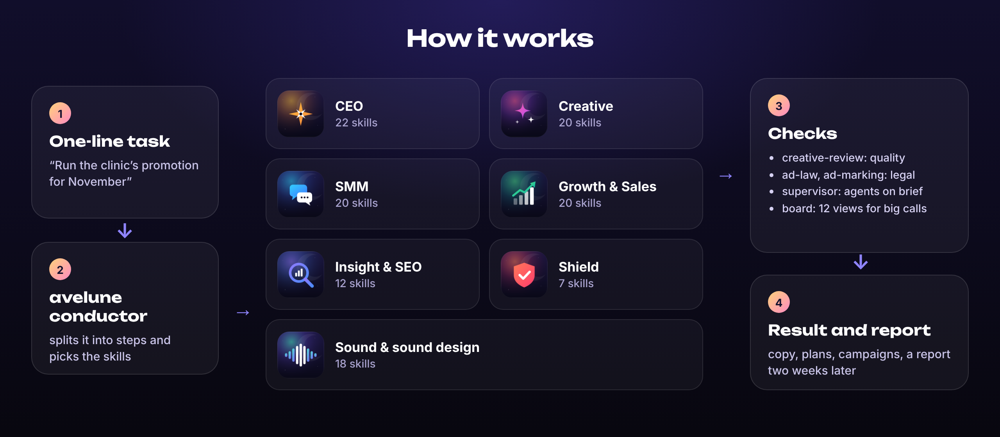

<p align="center"><picture><source media="(prefers-color-scheme: dark)" srcset="assets/banner-en-dark.png"></picture></p>

<p align="center">


</p>

<p align="center"><a href="README.md">Русский</a> · <b>English</b></p>

<p align="center"><i>For a coffee shop or a clinic, an online school or a factory, a local business or B2B.</i></p>

---

## What it is

**Avelune Labs** is a set of seven Claude Code plugins that work as one team: a CEO, a creative director, an SMM lead, a growth marketer, an analyst, an advertising lawyer and a sound designer. Inside are 119 skills, a 12-agent board of directors and supervision of every agent the coordinator launches.

Describe the task in plain words, such as “run our promotion for November” or “we get leads but no sales”. Claude picks the skills, runs the steps in order and checks the result.

> The skills are written in Russian and tuned for the Russian market (VK, Telegram, Yandex, 2GIS, Russian advertising and data law). Claude reads them in any language, and the methods and campaign references are universal.

## How it differs from just asking an AI

| Typical AI answer | With Avelune Labs |
|-------------------|-------------------|
| “Create engaging content” | A content plan with rubrics, hooks and dates, plus a CSV for any scheduler |
| “Our unique product is a game changer” | Banned clichés, a concrete detail instead of an adjective, an editor pass |
| Numbers “according to studies” | Source and date checked; without data, an explicit “Assumption:” and a quick way to test it |
| Advice that ignores the law | Ad marking, advertising law, personal data law, the 2026 Russian-language rule |
| One point of view | 12 independent board agents and an honest verdict: unanimous or not |
| Average-of-the-market creative | 33 reference campaigns, from Volkswagen “Think Small” to T-Bank |

<p align="center"></p>

## Plugins

<table><tr><td width="50%" valign="top">&nbsp;<a href="plugins/avelune-ceo/README.md"><b>CEO</b></a><br>&nbsp;<code>avelune-ceo</code> · 22 skills<br clear="left"><sub>Strategy, unit economics, pricing, hiring, negotiation. A 12-agent board, agent supervision and a conductor for all plugins.</sub></td><td width="50%" valign="top">&nbsp;<a href="plugins/avelune-creative/README.md"><b>Creative</b></a><br>&nbsp;<code>avelune-creative</code> · 20 skills<br clear="left"><sub>Big ideas, offers, hooks, headlines, landing pages, scripts, naming, slogans, brand voice, cliché-free editing.</sub></td></tr><tr><td width="50%" valign="top">&nbsp;<a href="plugins/avelune-smm/README.md"><b>SMM</b></a><br>&nbsp;<code>avelune-smm</code> · 20 skills<br clear="left"><sub>Content plans, newsjacking calendar, audits, community, negativity, influencers, Telegram, VK, Dzen, video, live.</sub></td><td width="50%" valign="top">&nbsp;<a href="plugins/avelune-growth/README.md"><b>Growth & Sales</b></a><br>&nbsp;<code>avelune-growth</code> · 20 skills<br clear="left"><sub>Market research, positioning, VK Ads, Yandex Direct, funnels, bots, launches, sales scripts, objections, retention, reviews, promos.</sub></td></tr><tr><td width="50%" valign="top">&nbsp;<a href="plugins/avelune-insight/README.md"><b>Insight & SEO</b></a><br>&nbsp;<code>avelune-insight</code> · 12 skills<br clear="left"><sub>Metrics, reports, forecasts, surveys, trends, mentions, SEO for AI answers, keyword research, maps.</sub></td><td width="50%" valign="top">&nbsp;<a href="plugins/avelune-shield/README.md"><b>Shield</b></a><br>&nbsp;<code>avelune-shield</code> · 7 skills<br clear="left"><sub>Russian ad marking, advertising and language law, platform rules, contracts, personal data, crisis, knowledge base.</sub></td></tr><tr><td width="50%" valign="top">&nbsp;<a href="plugins/avelune-sound/README.md"><b>Sound</b></a><br>&nbsp;<code>avelune-sound</code> · 18 skills<br clear="left"><sub>Sonic branding, sound for video and games, voice, effects, synthesis, mixing, mastering, DAFx algorithms, audio plugins.</sub></td><td width="50%" valign="top"></td></tr></table>

## Quick start

You need [Claude Code](https://code.claude.com/docs/en/overview).

```text
/plugin marketplace add angelmaycrv/avelune-labs
/plugin install avelune-ceo@avelune-labs
/plugin install avelune-creative@avelune-labs
/plugin install avelune-smm@avelune-labs
/plugin install avelune-growth@avelune-labs
/plugin install avelune-insight@avelune-labs
/plugin install avelune-shield@avelune-labs
/plugin install avelune-sound@avelune-labs
```

Install only what you need, for example just Creative and SMM. For a local clone: `/plugin marketplace add ./avelune-labs`.

The same from a regular terminal, without an open Claude Code session:

```bash
claude plugin marketplace add angelmaycrv/avelune-labs
claude plugin install avelune-ceo@avelune-labs
```

To update: `claude plugin marketplace update avelune-labs`, then `claude plugin update avelune-ceo@avelune-labs` and restart Claude Code. To remove a plugin: `claude plugin uninstall avelune-ceo@avelune-labs`.

Then describe a task:

```text
Run the dental clinic’s promotion for November, budget 150,000 rubles
```

The `avelune-ceo:avelune` conductor splits it into steps: metrics, maps, reviews, Yandex Direct, a content plan, a receptionist script and a report two weeks later. You can also call any skill directly, such as `/avelune-creative:offer` or `/avelune-insight:seo-audit`.

## Board and agent supervision

**Board.** `avelune-ceo:board` runs 12 agents: CFO, CMO, CPO, sales, operations, CTO, data, legal, brand, voice of the customer, risk and an independent director. Each one reviews the decision separately without seeing the others, and the verdict shows whether it is unanimous, who disagrees and why.

**Supervision.** Hooks in the CEO plugin remind the coordinator, at session start and after every agent run, that the agent’s result is not yet checked. The `avelune-ceo:supervisor` skill sets the routine: a brief with acceptance criteria before the run, a check against the brief after it, and a correction with specific points when the work drifts.

## Built on

- **Books and research:** Rackham, Dixon and Adamson, Voss, Cialdini, Byron Sharp, April Dunford, Ogilvy, Kahneman, Tetlock, Kaushik, Croll and Yoskovitz, Reichheld, Fitzpatrick, Coombs, Nielsen Norman Group and others.
- **Sound:** the DAFx conference archive (award winners 2018–2026), Chowning, Karplus and Strong, Julius O. Smith, Schroeder, Dattorro, Välimäki, Zölzer's «DAFX», Murch, Chion, Katz's «Mastering Audio», and loudness standards ITU-R BS.1770-5, EBU R 128, ATSC A/85 plus platform targets. The 68-work canon is in [`plugins/avelune-sound/skills/dafx/references.md`](plugins/avelune-sound/skills/dafx/references.md).
- **Campaigns:** 33 references with agency, year, insight and mechanics.
- **Platform and legal facts:** each with a source and a check date (November 2026), logged in [`docs/research-notes.md`](docs/research-notes.md).

## Full skill catalog

All 119 skills, with what each one is for and an example request, are in the [skill guide at the very bottom](#skill-guide).

## Limits

- Shield skills give a practical procedure, not a legal opinion. High-stakes decisions need a lawyer.
- Platforms and laws change several times a year. Facts were checked in November 2026, and the skills ask you to verify the current state.

## License

[MIT](LICENSE).

## Skill guide

All 119 skills: what each one is for and an example request. The skills themselves are written in Russian, but you can talk to them in English.

**How to call a skill.** There are three ways.

1. **You don't know which one you need.** Describe the task to the conductor: `/avelune-ceo:avelune No leads from the site, budget 100,000 rubles`. It picks the skills and walks you through the steps.
2. **You know the one you need.** Type the command from the table, a space and your request: `/avelune-ceo:board Open a second coffee shop or launch delivery?`
3. **No command at all.** Just describe the task in plain words; Claude usually picks the right skill by itself.

The more detail you give (niche, city, budget, numbers), the more precise the result.

### CEO · `avelune-ceo`

Decisions, money and people. Also home to the conductor that builds plans across all plugins.

| Skill | What it's for | Example request |
|---|---|---|
| [`/avelune-ceo:avelune`](plugins/avelune-ceo/skills/avelune/SKILL.md) | The main entry point. If you don't know which skill you need, describe the task in one line: the conductor builds a plan from skills across all plugins and walks you through it. | “No leads from the site, budget 100,000 rubles” |
| [`/avelune-ceo:board`](plugins/avelune-ceo/skills/board/SKILL.md) | For big decisions you can't afford to get wrong. 12 agents (finance, marketing, legal, risk, the customer's voice and others) judge the idea independently; the result shows who objects and why. | “Open a second coffee shop or launch delivery?” |
| [`/avelune-ceo:brainstorm`](plugins/avelune-ceo/skills/brainstorm/SKILL.md) | When you need ideas and have none. Produces 30–50 ideas with different techniques and picks the best by impact, confidence and ease (ICE). | “Promo ideas for a beauty salon for March 8” |
| [`/avelune-ceo:delegation`](plugins/avelune-ceo/skills/delegation/SKILL.md) | To hand off work and get what you meant the first time. Turns a task into a brief: goal, deliverable, acceptance criteria, deadline, budget. | “A brief for a designer: 5 banners for VK Ads” |
| [`/avelune-ceo:finmodel`](plugins/avelune-ceo/skills/finmodel/SKILL.md) | To see whether the money lasts and when you break even. A 12-month model with three scenarios and a cash-gap warning. | “Coffee shop: rent 150,000, average check 400 rubles, 120 guests a day” |
| [`/avelune-ceo:focus-week`](plugins/avelune-ceo/skills/focus-week/SKILL.md) | When everything is urgent and nothing gets done. Sorts your tasks, sets priorities, shows what to delegate or drop and lays the week out in your calendar. | “Here are 23 tasks for the week, help me sort them out” |
| [`/avelune-ceo:grants`](plugins/avelune-ceo/skills/grants/SKILL.md) | To find money without giving up equity: grants, subsidies, accelerators and competitions in Russia. Picks programs, checks requirements and writes the application with a budget. | “A grant for a kids' coding school in Kazan” |
| [`/avelune-ceo:hiring`](plugins/avelune-ceo/skills/hiring/SKILL.md) | To hire the right person. Role scorecard, job ad, interview questions, a test task and a rating scale for candidates. | “We're hiring a remote SMM manager” |
| [`/avelune-ceo:meeting-notes`](plugins/avelune-ceo/skills/meeting-notes/SKILL.md) | So agreements don't get lost. Turns notes or a transcript into minutes: decisions, tasks with owners and deadlines, a follow-up email. Before a meeting it drafts the agenda. | “Here's the transcript of the call with our contractor, write the minutes” |
| [`/avelune-ceo:negotiation`](plugins/avelune-ceo/skills/negotiation/SKILL.md) | To prepare for a negotiation and not give away too much. Goals, walk-away option, opening anchor, concessions and lines for hard moments. | “The landlord wants to raise the rent by 30%” |
| [`/avelune-ceo:onboarding`](plugins/avelune-ceo/skills/onboarding/SKILL.md) | So a new hire becomes useful fast and doesn't quit in month one. A plan for day one, week one and 30-60-90 days. | “A new salon receptionist starts on Monday” |
| [`/avelune-ceo:partner-letters`](plugins/avelune-ceo/skills/partner-letters/SKILL.md) | To write to strangers and actually get a reply: bloggers, media, partners, suppliers. Cold email, follow-up, decline, thank-you note. | “Propose a collab to the bakery next door” |
| [`/avelune-ceo:pitch`](plugins/avelune-ceo/skills/pitch/SKILL.md) | Before meeting an investor, accelerator or big client. A 10–12 slide outline, slide copy, a 3- and 10-minute talk and answers to hard questions. | “Pitch for an accelerator, asking for 5 million rubles” |
| [`/avelune-ceo:playbooks`](plugins/avelune-ceo/skills/playbooks/SKILL.md) | So the work runs without you. Writes procedures, instructions and checklists for everything you keep explaining. | “Procedure: how the receptionist answers leads from VK” |
| [`/avelune-ceo:postmortem`](plugins/avelune-ceo/skills/postmortem/SKILL.md) | To review a failure or a win without blame: what happened, why, and what changes so it doesn't happen again. | “We spent 200,000 on ads and got almost no leads” |
| [`/avelune-ceo:pricing`](plugins/avelune-ceo/skills/pricing/SKILL.md) | To set or raise prices without losing customers. Value-based pricing, a tier lineup and the announcement text. | “Raise the gym membership from 3,000 to 3,500 rubles” |
| [`/avelune-ceo:proposal`](plugins/avelune-ceo/skills/proposal/SKILL.md) | When a client asks for a proposal. A tailored proposal: their problem, your solution, results in numbers, packages and the next step. | “A proposal for a clinic chain to run their social media” |
| [`/avelune-ceo:risk-map`](plugins/avelune-ceo/skills/risk-map/SKILL.md) | Before a launch or a big deal. Shows what can go wrong, how likely and how painful it is, and the plan B. | “We're opening a location in a shopping mall” |
| [`/avelune-ceo:strategy-okr`](plugins/avelune-ceo/skills/strategy-okr/SKILL.md) | To decide what to do next when there are too many ideas. Diagnoses the situation, picks the main direction and turns it into goals and a plan for the quarter or year. | “Quarter: an online school's sales are falling” |
| [`/avelune-ceo:supervisor`](plugins/avelune-ceo/skills/supervisor/SKILL.md) | Makes sure agents stick to the brief and don't make up facts. Turns on by itself whenever agents are running. | No need to call it |
| [`/avelune-ceo:unit-economics`](plugins/avelune-ceo/skills/unit-economics/SKILL.md) | To see whether ads pay off and how much you can pay per customer. Calculates acquisition cost, lifetime value, margin and payback. | “A customer costs 2,000 rubles, average check 3,500, they buy 3 times a year” |
| [`/avelune-ceo:weekly-brief`](plugins/avelune-ceo/skills/weekly-brief/SKILL.md) | To see how the week went at a glance. A one-page summary: numbers vs plan, wins, fires and the decisions you need to make. | “Here are this week's numbers from the CRM and Metrica” |

### Creative · `avelune-creative`

Ideas and copy: from a big campaign idea to a headline and the final edit.

| Skill | What it's for | Example request |
|---|---|---|
| [`/avelune-creative:brand-story`](plugins/avelune-creative/skills/brand-story/SKILL.md) | When it feels like there's nothing to say about you. Finds the true story of the company or founder and shapes it for the website, a talk or a post series. | “A family bakery's story for the About page” |
| [`/avelune-creative:brand-voice`](plugins/avelune-creative/skills/brand-voice/SKILL.md) | When several people write and all sound different. A brand tone guide with a word list and before/after examples, plus checks of finished copy. | “Brand voice for a coffee shop chain, here are our posts” |
| [`/avelune-creative:case-studies`](plugins/avelune-creative/skills/case-studies/SKILL.md) | To tell a client's result in a way that sells. Interview questions, a before/after story with numbers and a finished case for the site, a post or a proposal. | “Case: we grew a gym's revenue 40% in 3 months” |
| [`/avelune-creative:cover-text`](plugins/avelune-creative/skills/cover-text/SKILL.md) | So people click your videos and carousels. 3–5 words of cover text, an image description and variants for an A/B test. | “Thumbnail for a YouTube video '5 mistakes when buying a laptop'” |
| [`/avelune-creative:creative-director`](plugins/avelune-creative/skills/creative-director/SKILL.md) | When you need a big idea that gets people talking. Finds the insight and spreads the idea across video, outdoor, social and PR, drawing on 33 famous campaigns. | “A campaign idea for a bakery's 10th anniversary, budget 500,000 rubles” |
| [`/avelune-creative:creative-review`](plugins/avelune-creative/skills/creative-review/SKILL.md) | To check creative before posting or launching ads. Scores it on 12 criteria, names the top 3 problems and gives a fixed version. | “Check this banner before launch” |
| [`/avelune-creative:director`](plugins/avelune-creative/skills/director/SKILL.md) | To turn an idea into a video you can actually shoot. Second-by-second storyboard, shots, light, sound, editing, phone filming and prompts for AI video. | “A 30-second ad for a flower shop” |
| [`/avelune-creative:editor`](plugins/avelune-creative/skills/editor/SKILL.md) | When copy is long, dull or sounds like AI. Cuts it, removes jargon and clichés, checks facts and shows every edit with a reason. | “Edit this post, it sounds too formal” |
| [`/avelune-creative:headlines`](plugins/avelune-creative/skills/headlines/SKILL.md) | When you need a headline, an email subject or a one-line offer. 15–25 options built on proven formulas, with a note on which is strongest. | “A headline for an article on choosing a kids' dentist” |
| [`/avelune-creative:hooks`](plugins/avelune-creative/skills/hooks/SKILL.md) | So people don't scroll past your video or post. 20+ options for the first 1–3 seconds or the first line, each one rated. | “Hooks for a video about a 5-day bathroom remodel” |
| [`/avelune-creative:landing-copy`](plugins/avelune-creative/skills/landing-copy/SKILL.md) | Sales page copy block by block: hero, problem, solution, proof, pricing, objections, call to action. It also rewrites a page that doesn't convert. | “A landing page for a manicure course” |
| [`/avelune-creative:memes-trends`](plugins/avelune-creative/skills/memes-trends/SKILL.md) | When a meme or a news story goes viral and you want to react. Says whether it's worth it, ties it to the product and drafts posts after checking the risks. | “Should we jump on this meme?” |
| [`/avelune-creative:naming`](plugins/avelune-creative/skills/naming/SKILL.md) | To name a company, product, plan or promo. 50–100 options, a shortlist, and domain and trademark checks. | “A name for a seaside yoga studio” |
| [`/avelune-creative:offer`](plugins/avelune-creative/skills/offer/SKILL.md) | When the product is good but few people buy. Builds an offer that's hard to refuse: value, price, guarantee, bonuses, a reason to buy now. | “An English course for 15,000 rubles, sales are weak” |
| [`/avelune-creative:platform-copy`](plugins/avelune-creative/skills/platform-copy/SKILL.md) | Ready-to-post copy for each platform. Rewrites one message for VK, Telegram, Dzen, YouTube, Reels and more, following each one's limits and habits. | “A coffee shop opening announcement for VK and Telegram” |
| [`/avelune-creative:reels-script`](plugins/avelune-creative/skills/reels-script/SKILL.md) | A script for a 7–60 second vertical video: hook, second-by-second shots, on-screen text, voiceover and a looping ending. | “A Reel showing how we make a bouquet in one minute” |
| [`/avelune-creative:repurpose`](plugins/avelune-creative/skills/repurpose/SKILL.md) | To get the most out of one recording. Turns a live stream, podcast, webinar or article into 20+ pieces of content and spreads them over a calendar. | “Here's the transcript of an hour-long webinar, cut it into content” |
| [`/avelune-creative:rubrics`](plugins/avelune-creative/skills/rubrics/SKILL.md) | So you stop asking 'what do we post today'. Invents recurring post series, each with a name, template, example and frequency. | “Post series for a car repair shop's Telegram channel, 4 posts a week” |
| [`/avelune-creative:slogans`](plugins/avelune-creative/skills/slogans/SKILL.md) | A slogan, tagline or closing line for a video. 30+ options judged on truth, rhythm and difference from competitors, checked against advertising law. | “A slogan for a family dental clinic” |
| [`/avelune-creative:storyteller`](plugins/avelune-creative/skills/storyteller/SKILL.md) | When you need a story, not a list of features. Comes up with plots, twists, dialogue and video series with recurring characters. | “A 5-video series about daily life at a car repair shop” |

### SMM · `avelune-smm`

Social media: what to post, how to grow and how to talk to people.

| Skill | What it's for | Example request |
|---|---|---|
| [`/avelune-smm:account-audit`](plugins/avelune-smm/skills/account-audit/SKILL.md) | When an account isn't growing or reach has dropped. A 48-point check, metrics, the top 5 problems and a 30-day plan. | “Audit our Telegram channel, reach has halved” |
| [`/avelune-smm:collabs`](plugins/avelune-smm/skills/collabs/SKILL.md) | To grow on a small budget through partners with the same audience. Finds partners, designs the format and writes the pitch. | “A collab for a stretching studio” |
| [`/avelune-smm:community`](plugins/avelune-smm/skills/community/SKILL.md) | When comments and messages pile up. Replies in the brand voice, templates for common cases, community rules and when to escalate. | “Sort these 50 comments and draft replies” |
| [`/avelune-smm:content-plan`](plugins/avelune-smm/skills/content-plan/SKILL.md) | When you don't know what to post. A posting plan for a week, month or quarter across platforms, with series and occasions, plus a CSV for your scheduler. | “A December content plan for Telegram and VK, I'm doing it alone” |
| [`/avelune-smm:crosspost`](plugins/avelune-smm/skills/crosspost/SKILL.md) | To publish one post or video everywhere without looking copy-pasted. Adapts length, format, captions, hashtags and links for each platform. | “Here's a video, adapt it for VK, Telegram, Dzen and Shorts” |
| [`/avelune-smm:dzen`](plugins/avelune-smm/skills/dzen/SKILL.md) | Free reach with articles and video. How to get into Dzen recommendations, which formats and topics work, how to repackage your site's articles. | “A Dzen channel for a family lawyer” |
| [`/avelune-smm:faq-bot`](plugins/avelune-smm/skills/faq-bot/SKILL.md) | When the same questions come in dozens of times a day. An answer base and a chatbot script with buttons, booking and handoff to a human. | “An FAQ bot for a car service's Telegram, here are the common questions” |
| [`/avelune-smm:giveaways`](plugins/avelune-smm/skills/giveaways/SKILL.md) | To run a giveaway that doesn't lose followers afterwards. Mechanics for your goal, rules, copy and a legal check. | “A New Year giveaway, the prize is a 5,000-ruble gift card” |
| [`/avelune-smm:influencers`](plugins/avelune-smm/skills/influencers/SKILL.md) | Influencer ads without wasted budget. Finding bloggers and checking them for fake followers, pricing, the pitch, the brief and ad labeling. | “Bloggers for a kids' online course, budget 100,000 rubles” |
| [`/avelune-smm:live`](plugins/avelune-smm/skills/live/SKILL.md) | To run a live stream people watch to the end. Topic, minute-by-minute plan, announcements, interaction, selling on air and cutting up the recording. | “A 40-minute Q&A live on apartment renovation” |
| [`/avelune-smm:negativity`](plugins/avelune-smm/skills/negativity/SKILL.md) | When an angry review or hate comes in. Says whether to reply and writes a response that calms the author and convinces everyone else reading. | “A customer says on Maps they were treated rudely, here's what actually happened” |
| [`/avelune-smm:newsjacking-calendar`](plugins/avelune-smm/skills/newsjacking-calendar/SKILL.md) | What to tie posts and promos to. Picks holidays, professional days and seasonal sales for your niche and says when to start preparing. | “Occasions for Q1 for a pet store” |
| [`/avelune-smm:profile-setup`](plugins/avelune-smm/skills/profile-setup/SKILL.md) | So a newcomer gets why to follow you within 3 seconds. Name, bio, pinned post, buttons and a brief for the avatar and cover. | “Set up a VK community for a barbershop” |
| [`/avelune-smm:short-video`](plugins/avelune-smm/skills/short-video/SKILL.md) | To reach new people with short videos. A strategy for Reels, Shorts, TikTok and VK Clips: topics, frequency, hook tests, stats review. For a single script use `reels-script`. | “A clip strategy for a pizzeria, we can shoot 3 a week” |
| [`/avelune-smm:stories`](plugins/avelune-smm/skills/stories/SKILL.md) | To talk to followers every day and warm them up to buy. A week of story scripts with polls, questions and buttons. | “A week of stories before course enrollment opens” |
| [`/avelune-smm:telegram-growth`](plugins/avelune-smm/skills/telegram-growth/SKILL.md) | To grow a Telegram channel. A 90-day strategy: setup, posts, subscriber sources, channel features and monetization. | “Our channel is stuck at 800 subscribers” |
| [`/avelune-smm:tg-seeding`](plugins/avelune-smm/skills/tg-seeding/SKILL.md) | To buy ads in Telegram channels. Picking and checking channels, budget, 10 ad post variants, a test plan and a results review. | “Ads for an investing channel, budget 50,000 rubles” |
| [`/avelune-smm:ugc`](plugins/avelune-smm/skills/ugc/SKILL.md) | Real content without a photo shoot. How to get photos, videos and reviews from customers, work with UGC creators and respect usage rights. | “How do we get customer photos wearing our sneakers?” |
| [`/avelune-smm:video-platforms`](plugins/avelune-smm/skills/video-platforms/SKILL.md) | Long-form video on YouTube, Rutube and VK Video. Channel strategy, video structure for retention, titles, thumbnails and descriptions. | “A video channel for a furniture factory” |
| [`/avelune-smm:vk-community`](plugins/avelune-smm/skills/vk-community/SKILL.md) | So a VK community brings in leads. Sections, products, booking and mailings, content for recommendations and selling right from the community. | “Relaunch a beauty salon's VK community” |

### Growth & Sales · `avelune-growth`

Customers and sales: ads, funnels, launches, scripts and retention.

| Skill | What it's for | Example request |
|---|---|---|
| [`/avelune-growth:ab-tests`](plugins/avelune-growth/skills/ab-tests/SKILL.md) | To find what works better by the numbers, not by gut feel. Hypothesis, sample size, duration and an honest verdict. | “Test two landing page headlines, 300 visits a day” |
| [`/avelune-growth:competitor-intel`](plugins/avelune-growth/skills/competitor-intel/SKILL.md) | To find out what competitors are doing. Their prices, offers, ads, customer reviews and a map of where you win and where you lose. | “Scout the three salons next door” |
| [`/avelune-growth:cro`](plugins/avelune-growth/skills/cro/SKILL.md) | When there's traffic but few leads. Reviews the page (hero, offer, trust, form, mobile) and gives a prioritized list of fixes. | “Here's the landing page, 0.8% conversion, traffic from Yandex Direct” |
| [`/avelune-growth:email`](plugins/avelune-growth/skills/email/SKILL.md) | Newsletters and email sequences: welcome, warm-up, abandoned cart, win-back. Plus deliverability and legal consent. | “An abandoned cart email sequence for an online store” |
| [`/avelune-growth:launch`](plugins/avelune-growth/skills/launch/SKILL.md) | To launch a product, location or new version. A plan from 30 days before to 30 days after, with a go/no-go checklist. | “Launching an online jewelry store on February 1” |
| [`/avelune-growth:lead-magnets`](plugins/avelune-growth/skills/lead-magnets/SKILL.md) | To collect contacts of future customers. Invents and writes a free resource (checklist, guide, quiz, sample) people trade their contact for. | “A lead magnet for an exam prep school” |
| [`/avelune-growth:market-research`](plugins/avelune-growth/skills/market-research/SKILL.md) | To learn who your customer is and whether there's demand before you spend money. Customer interviews, review mining, Wordstat demand and market size. | “Is there demand for a kids' climbing gym in Tver?” |
| [`/avelune-growth:objections`](plugins/avelune-growth/skills/objections/SKILL.md) | What to say to 'too expensive', 'I'll think about it', 'it's cheaper elsewhere'. Finds the real reason and gives answers for calls, chats and the landing page. | “Customers say our 2-million turnkey renovation is too expensive” |
| [`/avelune-growth:offline`](plugins/avelune-growth/skills/offline/SKILL.md) | Promoting a local business in its neighborhood. Signage, flyers with QR codes, partnerships with neighbors, events and how to track where customers came from. | “How do we bring locals to a new bakery, budget 30,000 rubles?” |
| [`/avelune-growth:positioning`](plugins/avelune-growth/skills/positioning/SKILL.md) | When you look like everyone else and customers don't see why you're better. Defines what you're compared with, what sets you apart and how to say it on the site and in ads. | “Why is our bookkeeping for sole traders better than the rest?” |
| [`/avelune-growth:promos`](plugins/avelune-growth/skills/promos/SKILL.md) | A promo that doesn't eat your profit. Picks the mechanic, calculates how much you need to sell, writes the terms and checks them against the law. | “A buy-2-get-1 Black Friday deal, 40% margin” |
| [`/avelune-growth:referral`](plugins/avelune-growth/skills/referral/SKILL.md) | So customers bring their friends. A refer-a-friend program: rewards for both sides, fraud protection, the math and invite copy. | “A referral program for a gym” |
| [`/avelune-growth:retention`](plugins/avelune-growth/skills/retention/SKILL.md) | When new customers are expensive and repeat purchases are rare. Finds where customers leave and builds loyalty and win-back. | “Only 20 of 100 new coffee shop guests come back” |
| [`/avelune-growth:reviews`](plugins/avelune-growth/skills/reviews/SKILL.md) | When reviews are few or the rating is falling. How to honestly collect reviews, reply to them and fight fakes. | “Our Yandex Maps rating is 4.1, how do we raise it?” |
| [`/avelune-growth:sales-funnel`](plugins/avelune-growth/skills/sales-funnel/SKILL.md) | To find where customers drop off. Builds the funnel from first touch to repeat purchase and calculates conversion and money at each step. | “Ads are running but sales are low, here are the numbers per step” |
| [`/avelune-growth:sales-scripts`](plugins/avelune-growth/skills/sales-scripts/SKILL.md) | When there are leads but few sales. Scripts for calls, chats and meetings: questions, presentation, price, objections, next step. | “A script for a clinic receptionist on inbound calls” |
| [`/avelune-growth:tg-bot-funnel`](plugins/avelune-growth/skills/tg-bot-funnel/SKILL.md) | Automated sales in a messenger. A bot script from the first message to payment: questions, lead magnet, warm-up, offer, reminders. | “A bot funnel for a weight-loss challenge” |
| [`/avelune-growth:vk-ads`](plugins/avelune-growth/skills/vk-ads/SKILL.md) | To run VK ads without wasting budget. Goal, audiences, pixel, creatives, copy that passes moderation, a test budget and a results review. | “VK Ads for sushi delivery in Samara, 60,000 rubles a month” |
| [`/avelune-growth:warmup`](plugins/avelune-growth/skills/warmup/SKILL.md) | To get the audience ready to buy. A 5–21 day warm-up: problem, trust, cases, objections, sales opening and an honest deadline. | “A warm-up before course sales open on December 1” |
| [`/avelune-growth:yandex-direct`](plugins/avelune-growth/skills/yandex-direct/SKILL.md) | Search ads in Yandex. Keywords and negative keywords, ads, Metrica goals, bidding strategies and a search query review. | “Yandex Direct for washing machine repair in Moscow” |

### Insight & SEO · `avelune-insight`

Numbers and search: metrics, reports, forecasts, SEO and maps.

| Skill | What it's for | Example request |
|---|---|---|
| [`/avelune-insight:forecast`](plugins/avelune-insight/skills/forecast/SKILL.md) | To estimate future sales, leads or traffic. Three scenarios with ranges and stated assumptions. | “How many leads will Yandex Direct bring for 80,000 rubles a month?” |
| [`/avelune-insight:local-seo`](plugins/avelune-insight/skills/local-seo/SKILL.md) | For businesses with an address. Listings on Yandex Maps, 2GIS and Google Maps: setup, photos, reviews, replies and the link to your site. | “Rank our salon above the neighbors on Yandex Maps” |
| [`/avelune-insight:mentions`](plugins/avelune-insight/skills/mentions/SKILL.md) | To know what people say online about you and your competitors. Monitoring queries, tools, sorting mentions and a response routine. | “Set up mention monitoring for a clinic chain” |
| [`/avelune-insight:metrics`](plugins/avelune-insight/skills/metrics/SKILL.md) | To decide what counts as success. Picks the main metric and builds a metric tree from money down to team actions. | “Which metrics should an online school track?” |
| [`/avelune-insight:post-autopsy`](plugins/avelune-insight/skills/post-autopsy/SKILL.md) | To understand why a post took off or flopped. Compares it with the account's usual numbers and gives one hypothesis for the next piece. | “This video got 10x the usual views, why?” |
| [`/avelune-insight:report`](plugins/avelune-insight/skills/report/SKILL.md) | A numbers report for a manager, client or team. Compares with the plan and the last period, explains why and ends with decisions. | “October report, here are the exports from Metrica and VK Ads” |
| [`/avelune-insight:semantics`](plugins/avelune-insight/skills/semantics/SKILL.md) | To learn what your customers search for. Collects and groups search queries and maps them to site pages and ads. | “Keywords for a stretch ceiling company's site in Kazan” |
| [`/avelune-insight:seo-articles`](plugins/avelune-insight/skills/seo-articles/SKILL.md) | Articles that bring customers from search and AI answers. Topic from real queries, structure, the author's expertise and meta tags. | “Article 'How much does a dental implant cost in 2026'” |
| [`/avelune-insight:seo-audit`](plugins/avelune-insight/skills/seo-audit/SKILL.md) | When search traffic is low. A site audit for Yandex and Google, AI answers included, with a prioritized list of problems. | “An SEO audit for a dental clinic's site in Yekaterinburg” |
| [`/avelune-insight:surveys`](plugins/avelune-insight/skills/surveys/SKILL.md) | To get the truth from customers: why they came, why they left, what stops them from buying. Unbiased questions, the survey format and conclusions. | “A survey of members who left the gym” |
| [`/avelune-insight:trends`](plugins/avelune-insight/skills/trends/SKILL.md) | What's rising right now and whether to act on it. Tells a three-day meme from a multi-year shift and says what to do while there's time. | “This month's trends for a cosmetics store” |
| [`/avelune-insight:video-seo`](plugins/avelune-insight/skills/video-seo/SKILL.md) | So your videos get found in search and recommendations. A title for the query, description, timestamps, subtitles and thumbnail. | “Optimize a how-to video for VK Video and Rutube” |

### Shield · `avelune-shield`

Law and safety: ad labeling, advertising law, personal data, contracts and crises.

| Skill | What it's for | Example request |
|---|---|---|
| [`/avelune-shield:ad-law`](plugins/avelune-shield/skills/ad-law/SKILL.md) | To check ad copy against Russian law. Reviews each phrase ('best', 'No. 1', discounts, comparisons, sensitive niches, Russian-language rules) and gives a safe replacement. | “Check the clinic's ad before launch” |
| [`/avelune-shield:ad-marking`](plugins/avelune-shield/skills/ad-marking/SKILL.md) | Before any online ad in Russia. How to get an erid, add the 'Реклама' label and avoid fines: channel ads, bloggers, targeting, banners. | “We're placing a post with a blogger, what do we need for labeling?” |
| [`/avelune-shield:contracts`](plugins/avelune-shield/skills/contracts/SKILL.md) | Contracts and public offers for marketing: with a blogger, agency or freelancer, an offer for an online school. It also checks someone else's contract for risks. | “A contract with a blogger for an integration” |
| [`/avelune-shield:crisis`](plugins/avelune-shield/skills/crisis/SKILL.md) | When negativity goes beyond a single review. A plan for the first hour and the first day, statements for social media, press and customers. | “A guest got food poisoning at our restaurant and the post spread across city groups” |
| [`/avelune-shield:knowledge-base`](plugins/avelune-shield/skills/knowledge-base/SKILL.md) | So the team and Claude don't mix up facts about your business. One source of truth: products, prices, rules, tone, decisions, and how to connect it to Claude. | “Build a knowledge base for a beauty salon” |
| [`/avelune-shield:personal-data`](plugins/avelune-shield/skills/personal-data/SKILL.md) | Before launching a form, bot or mailing. Data processing consents under Russia's 152-FZ, a privacy policy and a checklist to avoid fines. | “We collect phone numbers through a site quiz, what does the law require?” |
| [`/avelune-shield:platform-rules`](plugins/avelune-shield/skills/platform-rules/SKILL.md) | To avoid bans, strikes and rejected ads. The rules of VK, Telegram, Dzen, Rutube, Yandex Direct, marketplaces and maps, and what to do if you're blocked. | “Our VK ad was blocked, what now?” |

### Sound · `avelune-sound`

Sound for business, content, games and products, mixing and loudness, DAFx algorithms and audio plugin development.

| Skill | What it's for | Example request |
|---|---|---|
| [`/avelune-sound:audio-ml`](plugins/avelune-sound/skills/audio-ml/SKILL.md) | Neural networks for audio. Amp modelling, DDSP, generation, stem separation, data rights. | "Train a model of my guitar amp" |
| [`/avelune-sound:dafx`](plugins/avelune-sound/skills/dafx/SKILL.md) | Find the best known method in the research. A canon of 68 works and DAFx award winners 2018–2026 with practical takeaways. | "What should I read on distortion antialiasing?" |
| [`/avelune-sound:dsp-effects`](plugins/avelune-sound/skills/dsp-effects/SKILL.md) | Build or fix an effect. Delays, filters, compressors, time stretching, spectral processing. | "Why does my filter click under automation?" |
| [`/avelune-sound:game-audio`](plugins/avelune-sound/skills/game-audio/SKILL.md) | Game audio of any size. Variation without repeats, adaptive music, mixing and loudness for console and mobile. | "Sound for a mobile runner in Unity and FMOD" |
| [`/avelune-sound:mastering`](plugins/avelune-sound/skills/mastering/SKILL.md) | Before release. Platform loudness targets with sources, a mastering chain, delivery formats. | "What loudness should I master to for Spotify and YouTube?" |
| [`/avelune-sound:mixing`](plugins/avelune-sound/skills/mixing/SKILL.md) | Mix a track or a video. Workflow, frequency map, compression, diagnosing "muddy, quiet, flat". | "The mix is muddy next to the reference" |
| [`/avelune-sound:plugin-dev`](plugins/avelune-sound/skills/plugin-dev/SKILL.md) | Write an audio plugin. Stack choice, real-time rules, parameters, testing and release. | "My JUCE plugin crashes in Ableton when the buffer size changes" |
| [`/avelune-sound:reverb`](plugins/avelune-sound/skills/reverb/SKILL.md) | Space in a mix or your own reverb. Settings by source, FDN, Dattorro, shimmer. | "The reverb is muddying the vocal" |
| [`/avelune-sound:sfx-design`](plugins/avelune-sound/skills/sfx-design/SKILL.md) | When the sound you need isn't in any library. Layering, source processing, recipes for hits, whooshes, magic, creatures. | "Build a punch sound for a fighting game" |
| [`/avelune-sound:sonic-branding`](plugins/avelune-sound/skills/sonic-branding/SKILL.md) | So people recognise the brand by ear. Sonic logo, motif, palette, adaptations and recognition tests. | "A sonic logo for a bakery chain" |
| [`/avelune-sound:sound-director`](plugins/avelune-sound/skills/sound-director/SKILL.md) | When you don't know where to start with sound. Writes a sound brief and a chain of skills, checks the seams. | "We need sound for an app launch and ad videos" |
| [`/avelune-sound:sound-review`](plugins/avelune-sound/skills/sound-review/SKILL.md) | Before delivery. 12 scored criteria, the main problems and concrete fixes. | "Check the ad's sound before we send it" |
| [`/avelune-sound:spatial-audio`](plugins/avelune-sound/skills/spatial-audio/SKILL.md) | When the mix is narrow or you need sound around the head. Stereo and mono, binaural, Ambisonics, Atmos. | "A binaural version of an audio drama" |
| [`/avelune-sound:synthesis`](plugins/avelune-sound/skills/synthesis/SKILL.md) | Build a sound on a synth or in code. Which synthesis to use, recipes for drums, basses, bells, strings. | "How do I make an FM bell in Vital?" |
| [`/avelune-sound:ui-sounds`](plugins/avelune-sound/skills/ui-sounds/SKILL.md) | App sounds that help instead of annoy. Event sound set, haptics, levels, accessibility. | "Sounds for a banking app" |
| [`/avelune-sound:video-sound`](plugins/avelune-sound/skills/video-sound/SKILL.md) | When a video sounds cheap or the voice drowns in music. Second-by-second sound plan, licensed music, a mix for phone speakers. | "Sound for a 15-second VK Clips video" |
| [`/avelune-sound:virtual-analog`](plugins/avelune-sound/skills/virtual-analog/SKILL.md) | Emulate an analog circuit. ADAA, ladder filters, WDF, DK method, tape and tubes. | "Emulate an overdrive pedal from its schematic" |
| [`/avelune-sound:voice`](plugins/avelune-sound/skills/voice/SKILL.md) | Clean, intelligible voice. Home recording, processing chain, podcasts, voice-over briefs, AI voices and rights. | "The podcast voice is muffled and noisy" |
