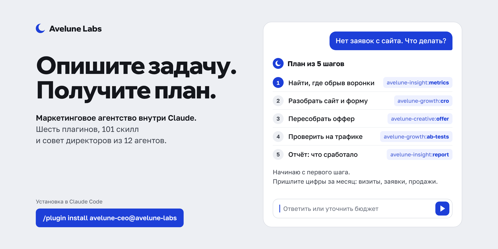
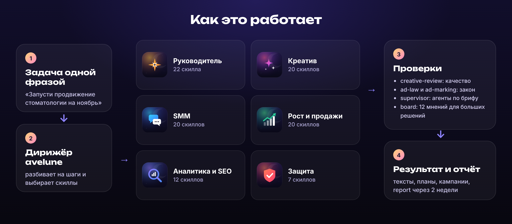

<p align="center"><picture><source media="(prefers-color-scheme: dark)" srcset="assets/banner-ru-dark.png"></picture></p>

<p align="center">


</p>

<p align="center"><b>Русский</b> · <a href="README.en.md">English</a></p>

<p align="center"><i>Для кофейни и клиники, онлайн-школы и производства, локального бизнеса и B2B.</i></p>

---

## Что это

**Avelune Labs** это шесть плагинов для Claude Code. Вместе они работают как команда: руководитель, креативный директор, SMM-специалист, маркетолог по росту, аналитик и юрист по рекламе. Внутри 101 скилл, совет директоров из 12 агентов и надзор координатора за агентами.

Вы пишете задачу обычными словами: «запусти продвижение на ноябрь», «почему заявки есть, а продаж нет», «проверь рекламу клиники». Claude выбирает нужные скиллы, проходит шаги по порядку и проверяет результат.

## Чем отличается от «просто спросить нейросеть»

| Обычный ответ ИИ | С Avelune Labs |
|------------------|----------------|
| «Создавайте вовлекающий контент» | Контент-план с рубриками, хуками и датами плюс CSV для любого планировщика |
| «Наш уникальный продукт меняет правила игры» | Запрещённые штампы, конкретная деталь вместо прилагательного, проверка редактором |
| Цифры «по данным исследований» | Источник и дата проверки. Где данных нет, пометка «Допущение:» и способ быстро проверить |
| Совет без учёта закона | Маркировка рекламы, 38-ФЗ, 152-ФЗ, закон о русском языке с 1 марта 2026 года |
| Один взгляд на решение | 12 независимых агентов совета и честный итог: единогласно или нет |
| Креатив «в среднем по рынку» | 33 разобранные кампании-эталона, от Volkswagen «Think Small» до Т-Банка |

<p align="center"></p>

## Плагины

<table><tr><td width="50%" valign="top">&nbsp;<a href="plugins/avelune-ceo/README.md"><b>Руководитель</b></a><br>&nbsp;<code>avelune-ceo</code> · 22 скилла<br clear="left"><sub>Стратегия, юнит-экономика, цены, найм, переговоры. Совет из 12 агентов, надзор за агентами и дирижёр всех плагинов.</sub></td><td width="50%" valign="top">&nbsp;<a href="plugins/avelune-creative/README.md"><b>Креатив и тексты</b></a><br>&nbsp;<code>avelune-creative</code> · 20 скиллов<br clear="left"><sub>Большие идеи, офферы, хуки, заголовки, лендинги, сценарии, нейминг, слоганы, голос бренда, редактура без штампов.</sub></td></tr><tr><td width="50%" valign="top">&nbsp;<a href="plugins/avelune-smm/README.md"><b>SMM</b></a><br>&nbsp;<code>avelune-smm</code> · 20 скиллов<br clear="left"><sub>Контент-план, инфоповоды, аудит, комьюнити, негатив, блогеры, посевы, Telegram, VK, Дзен, видео, эфиры.</sub></td><td width="50%" valign="top">&nbsp;<a href="plugins/avelune-growth/README.md"><b>Рост и продажи</b></a><br>&nbsp;<code>avelune-growth</code> · 20 скиллов<br clear="left"><sub>Рынок, позиционирование, VK Реклама, Директ, воронки, боты, запуски, скрипты, возражения, удержание, отзывы, акции.</sub></td></tr><tr><td width="50%" valign="top">&nbsp;<a href="plugins/avelune-insight/README.md"><b>Аналитика и SEO</b></a><br>&nbsp;<code>avelune-insight</code> · 12 скиллов<br clear="left"><sub>Метрики, отчёты, прогнозы, опросы, тренды, упоминания, SEO с учётом нейроответов, семантика, карты.</sub></td><td width="50%" valign="top">&nbsp;<a href="plugins/avelune-shield/README.md"><b>Защита</b></a><br>&nbsp;<code>avelune-shield</code> · 7 скиллов<br clear="left"><sub>Маркировка рекламы, закон о рекламе и русском языке, правила площадок, договоры, 152-ФЗ, антикризис, база знаний.</sub></td></tr></table>

## Быстрый старт

Нужен [Claude Code](https://code.claude.com/docs/en/overview).

```text
/plugin marketplace add angelmaycrv/avelune-labs
/plugin install avelune-ceo@avelune-labs
/plugin install avelune-creative@avelune-labs
/plugin install avelune-smm@avelune-labs
/plugin install avelune-growth@avelune-labs
/plugin install avelune-insight@avelune-labs
/plugin install avelune-shield@avelune-labs
```

Можно ставить не всё: например, только «Креатив» и «SMM». Для локальной копии репозитория: `/plugin marketplace add ./avelune-labs`.

То же из обычного терминала, без открытой сессии Claude Code:

```bash
claude plugin marketplace add angelmaycrv/avelune-labs
claude plugin install avelune-ceo@avelune-labs
```

Обновить до новой версии: `claude plugin marketplace update avelune-labs`, затем `claude plugin update avelune-ceo@avelune-labs` и перезапуск Claude Code. Удалить плагин: `claude plugin uninstall avelune-ceo@avelune-labs`.

Потом просто напишите задачу:

```text
Запусти продвижение стоматологии на ноябрь, бюджет 150 тысяч
```

Дирижёр `avelune-ceo:avelune` разобьёт её на шаги: метрики, карты, отзывы, Директ, контент-план, скрипт администратора, отчёт через две недели. Любой скилл можно вызвать и напрямую: `/avelune-creative:offer`, `/avelune-insight:seo-audit`.

## Типовые цепочки

| Задача | Цепочка скиллов |
|--------|-----------------|
| Новый продукт с нуля | market-research → competitor-intel → positioning → pricing → unit-economics → naming → offer → landing-copy |
| «Нет заявок» | metrics → cro или vk-ads / yandex-direct / local-seo → offer → ab-tests → report |
| «Заявки есть, продаж нет» | sales-funnel → sales-scripts → objections → retention → report |
| Продвижение на месяц | metrics → content-plan → rubrics → hooks → platform-copy → creative-review → report |
| Запуск курса или тарифа | positioning → offer → lead-magnets → tg-bot-funnel → warmup → launch → contracts → personal-data |
| Открытие точки | market-research → naming → offline → local-seo → reviews → promos → forecast |
| Репутационный кризис | crisis → negativity → mentions → reviews → postmortem |
| Большое решение | brainstorm → risk-map → finmodel → board |

## Совет директоров и надзор за агентами

**Совет.** Скилл `avelune-ceo:board` запускает 12 агентов: финансовый директор, директор по маркетингу, по продукту, коммерческий, операционный, технический, по данным, юрист, хранитель бренда, голос клиента, риск-менеджер и независимый директор. Каждый оценивает решение отдельно, не видя мнений остальных. Итог честно показывает, единогласно ли решение, кто против и почему.

**Надзор.** Хуки плагина «Руководитель» при старте сессии и после каждого запуска агента напоминают координатору: результат агента ещё не проверен. Скилл `avelune-ceo:supervisor` задаёт порядок: бриф с критериями приёмки до запуска, проверка по брифу после, поправка агента конкретными пунктами.

## На чём основано

- **Книги и исследования:** Rackham «SPIN Selling», Dixon и Adamson «The Challenger Sale», Voss «Never Split the Difference», Cialdini «Influence», Byron Sharp «How Brands Grow», Dunford «Obviously Awesome», Ogilvy, Kahneman, Tetlock, Kaushik, Croll и Yoskovitz «Lean Analytics», Reichheld (NPS), Fitzpatrick «The Mom Test», Coombs (антикризис), Nielsen Norman Group и другие.
- **Кейсы:** 33 кампании с агентством, годом, инсайтом и механикой; российские кейсы помечены для сверки.
- **Факты о площадках и законах:** с источником и датой проверки (ноябрь 2026). Журнал проверенных фактов лежит в [`docs/research-notes.md`](docs/research-notes.md), план изучения в [`docs/research-plan.md`](docs/research-plan.md).

## Принципы качества

1. **Любая ниша.** Примеры из разных бизнесов, правила общие.
2. **Факт с источником.** Без источника цифра становится «Допущением:» со способом проверки.
3. **Без ИИ-штампов.** Общий блок правил в каждом творческом скилле и отдельный скилл-редактор.
4. **Закон встроен.** Маркировка, персональные данные, достоверность рекламы проверяются до публикации.
5. **Гипотеза → тест → решение.** Каждое предложение с метрикой, сроком и порогом.

## Полный каталог скиллов

Все 101 скилл с объяснением, зачем каждый нужен, и примером запроса собраны в [справочнике в самом низу](#справочник-скиллов).

## Ограничения

- Скиллы «Защиты» дают практический порядок действий, но не заменяют юриста в решениях с высоким риском.
- Площадки и законы меняются несколько раз в год. Факты проверены на ноябрь 2026 года; скиллы просят сверять актуальное.
- Скиллы написаны на русском и ориентированы на российский рынок (VK, Telegram, Яндекс, 2ГИС, российские законы). Методы и примеры кампаний универсальны.

## Структура репозитория

```text
avelune-labs/
├── .claude-plugin/marketplace.json   каталог из 6 плагинов
├── plugins/
│   ├── avelune-ceo/        22 скилла, 12 агентов совета, хуки надзора
│   ├── avelune-creative/   20 скиллов, база из 33 кампаний
│   ├── avelune-smm/        20 скиллов
│   ├── avelune-growth/     20 скиллов
│   ├── avelune-insight/    12 скиллов
│   └── avelune-shield/     7 скиллов
├── docs/                   план изучения и журнал проверенных фактов
└── assets/                 баннеры, схема, иконки и их исходники
```

## Лицензия

[MIT](LICENSE). Пользуйтесь, меняйте, адаптируйте под свой бизнес.

## Справочник скиллов

Все 101 скилл: зачем каждый нужен и пример запроса.

**Как вызвать скилл.** Есть три способа.

1. **Не знаете, какой нужен.** Опишите задачу дирижёру: `/avelune-ceo:avelune Нет заявок с сайта, бюджет 100 тысяч`. Он сам выберет скиллы и проведёт по шагам.
2. **Знаете нужный.** Напишите команду из таблицы, пробел и запрос: `/avelune-ceo:board Открывать вторую кофейню или запускать доставку?`
3. **Без команды.** Просто опишите задачу словами, Claude обычно сам подключает подходящий скилл.

Чем больше подробностей в запросе (ниша, город, бюджет, цифры), тем точнее результат.

### Руководитель · `avelune-ceo`

Решения, деньги и люди. Здесь же дирижёр, который собирает план из всех плагинов.

| Скилл | Зачем нужен | Пример запроса |
|---|---|---|
| [`/avelune-ceo:avelune`](plugins/avelune-ceo/skills/avelune/SKILL.md) | Главная точка входа. Если не знаете, какой скилл нужен, опишите задачу одной фразой: дирижёр сам составит план из скиллов всех плагинов и проведёт по шагам. | «Нет заявок с сайта, бюджет 100 тысяч» |
| [`/avelune-ceo:board`](plugins/avelune-ceo/skills/board/SKILL.md) | Для важных решений, где страшно ошибиться. 12 агентов (финансы, маркетинг, юрист, риски, голос клиента и другие) оценивают идею независимо, итог показывает, кто против и почему. | «Открывать вторую кофейню или запускать доставку?» |
| [`/avelune-ceo:brainstorm`](plugins/avelune-ceo/skills/brainstorm/SKILL.md) | Когда нужны идеи, а в голове пусто. Выдаёт 30–50 идей разными техниками и отбирает лучшие по влиянию, уверенности и простоте (ICE). | «Идеи акции для салона красоты к 8 Марта» |
| [`/avelune-ceo:delegation`](plugins/avelune-ceo/skills/delegation/SKILL.md) | Чтобы поручить работу и получить нужное с первого раза. Превращает задачу в ТЗ: цель, результат, критерии приёмки, сроки, бюджет. | «ТЗ дизайнеру на 5 баннеров для VK Рекламы» |
| [`/avelune-ceo:finmodel`](plugins/avelune-ceo/skills/finmodel/SKILL.md) | Понять, хватит ли денег и когда выйдете в ноль. Модель на 12 месяцев с тремя сценариями и предупреждением о кассовом разрыве. | «Кофейня: аренда 150 тысяч, средний чек 400 рублей, 120 гостей в день» |
| [`/avelune-ceo:focus-week`](plugins/avelune-ceo/skills/focus-week/SKILL.md) | Когда всё горит и ничего не успевается. Разбирает дела, расставляет приоритеты, подсказывает, что поручить и что выбросить, и раскладывает неделю по календарю. | «Вот 23 дела на неделю, помоги разобраться» |
| [`/avelune-ceo:grants`](plugins/avelune-ceo/skills/grants/SKILL.md) | Найти деньги без отдачи доли: гранты, субсидии, акселераторы и конкурсы в России. Подбирает программы, проверяет требования и пишет заявку с бюджетом. | «Грант на детскую IT-школу в Казани» |
| [`/avelune-ceo:hiring`](plugins/avelune-ceo/skills/hiring/SKILL.md) | Нанять человека и не ошибиться. Карта роли, текст вакансии, вопросы для интервью, тестовое задание и шкала оценки кандидатов. | «Нанимаем SMM-менеджера на удалёнку» |
| [`/avelune-ceo:meeting-notes`](plugins/avelune-ceo/skills/meeting-notes/SKILL.md) | Чтобы договорённости не терялись. Из заметок или расшифровки делает протокол: решения, задачи с владельцами и сроками, письмо участникам. Перед встречей готовит повестку. | «Вот расшифровка созвона с подрядчиком, сделай протокол» |
| [`/avelune-ceo:negotiation`](plugins/avelune-ceo/skills/negotiation/SKILL.md) | Подготовиться к торгу и не уступить лишнего. Цели, запасной вариант, первая цена, уступки и фразы для трудных моментов. | «Арендодатель хочет поднять аренду на 30%» |
| [`/avelune-ceo:onboarding`](plugins/avelune-ceo/skills/onboarding/SKILL.md) | Чтобы новый сотрудник быстро начал приносить пользу и не ушёл в первый месяц. План первого дня, первой недели и 30-60-90 дней. | «В понедельник выходит новый администратор салона» |
| [`/avelune-ceo:partner-letters`](plugins/avelune-ceo/skills/partner-letters/SKILL.md) | Написать незнакомым людям так, чтобы ответили: блогерам, СМИ, партнёрам, поставщикам. Холодное письмо, напоминание, отказ, благодарность. | «Предложи коллаборацию соседней пекарне» |
| [`/avelune-ceo:pitch`](plugins/avelune-ceo/skills/pitch/SKILL.md) | Перед встречей с инвестором, акселератором или крупным клиентом. Структура на 10–12 слайдов, текст слайдов, речь на 3 и 10 минут и ответы на трудные вопросы. | «Питч для акселератора, просим 5 млн» |
| [`/avelune-ceo:playbooks`](plugins/avelune-ceo/skills/playbooks/SKILL.md) | Чтобы работа шла без вас. Пишет регламенты, инструкции и чек-листы для всего, что приходится объяснять снова и снова. | «Регламент: как администратор отвечает на заявки из VK» |
| [`/avelune-ceo:postmortem`](plugins/avelune-ceo/skills/postmortem/SKILL.md) | Разобрать провал или успех без поиска виноватых: что случилось, почему и что меняем, чтобы не повторилось. | «Слили 200 тысяч на рекламу, заявок почти нет» |
| [`/avelune-ceo:pricing`](plugins/avelune-ceo/skills/pricing/SKILL.md) | Поставить или поднять цену, не потеряв клиентов. Цена от ценности для клиента, линейка тарифов и текст анонса повышения. | «Поднять абонемент в фитнес-клуб с 3000 до 3500» |
| [`/avelune-ceo:proposal`](plugins/avelune-ceo/skills/proposal/SKILL.md) | Когда клиент просит КП. Коммерческое предложение под конкретного клиента: его проблема, решение, результат в цифрах, пакеты и следующий шаг. | «КП для сети клиник на ведение соцсетей» |
| [`/avelune-ceo:risk-map`](plugins/avelune-ceo/skills/risk-map/SKILL.md) | Перед запуском или крупной сделкой. Показывает, что может пойти не так, насколько это вероятно и больно, и какой план Б. | «Открываем точку в торговом центре» |
| [`/avelune-ceo:strategy-okr`](plugins/avelune-ceo/skills/strategy-okr/SKILL.md) | Понять, что делать дальше, когда идей много. Ставит диагноз, выбирает главное направление и превращает его в цели и план на квартал или год. | «Квартал: у онлайн-школы падают продажи» |
| [`/avelune-ceo:supervisor`](plugins/avelune-ceo/skills/supervisor/SKILL.md) | Следит, чтобы агенты делали работу по брифу и не выдумывали факты. Включается сам, когда работают агенты. | Вызывать не нужно |
| [`/avelune-ceo:unit-economics`](plugins/avelune-ceo/skills/unit-economics/SKILL.md) | Понять, окупается ли реклама и сколько можно платить за клиента. Считает стоимость привлечения, доход с клиента за всё время, маржу и срок окупаемости. | «Клиент стоит 2000 рублей, средний чек 3500, покупают 3 раза в год» |
| [`/avelune-ceo:weekly-brief`](plugins/avelune-ceo/skills/weekly-brief/SKILL.md) | Быстро понять, как прошла неделя. Сводка на одну страницу: цифры против плана, победы, проблемы и решения, которые нужны от вас. | «Вот цифры за неделю из CRM и Метрики» |

### Креатив и тексты · `avelune-creative`

Идеи и тексты: от большой идеи кампании до заголовка и финальной редактуры.

| Скилл | Зачем нужен | Пример запроса |
|---|---|---|
| [`/avelune-creative:brand-story`](plugins/avelune-creative/skills/brand-story/SKILL.md) | Когда кажется, что про вас нечего рассказать. Находит правдивую историю компании или основателя и упаковывает её для сайта, выступления или серии постов. | «История семейной пекарни для страницы «О нас»» |
| [`/avelune-creative:brand-voice`](plugins/avelune-creative/skills/brand-voice/SKILL.md) | Когда тексты пишут несколько человек и все по-разному. Гайд по тону бренда со словарём и примерами «было / стало», плюс проверка готовых текстов. | «Голос бренда для сети кофеен, вот наши посты» |
| [`/avelune-creative:case-studies`](plugins/avelune-creative/skills/case-studies/SKILL.md) | Рассказать о результате клиента так, чтобы это продавало. Вопросы для интервью, история «было, сделали, стало» с цифрами и готовый кейс для сайта, поста или КП. | «Кейс: подняли выручку фитнес-клуба на 40% за 3 месяца» |
| [`/avelune-creative:cover-text`](plugins/avelune-creative/skills/cover-text/SKILL.md) | Чтобы по видео и каруселям кликали. Текст обложки в 3–5 слов, описание картинки и варианты для A/B-теста. | «Обложка для ролика «5 ошибок при выборе ноутбука» на YouTube» |
| [`/avelune-creative:creative-director`](plugins/avelune-creative/skills/creative-director/SKILL.md) | Когда нужна большая идея, чтобы о бренде заговорили. Ищет инсайт и разворачивает идею в ролик, наружку, соцсети и PR. Опирается на 33 знаменитые кампании. | «Идея кампании к 10-летию пекарни, бюджет 500 тысяч» |
| [`/avelune-creative:creative-review`](plugins/avelune-creative/skills/creative-review/SKILL.md) | Проверить креатив перед публикацией или запуском рекламы. Оценка по 12 критериям, 3 главные проблемы и исправленная версия. | «Проверь этот баннер перед запуском» |
| [`/avelune-creative:director`](plugins/avelune-creative/skills/director/SKILL.md) | Превратить идею в ролик, который реально снять. Раскадровка по секундам, планы, свет, звук, монтаж, съёмка на телефон и промпты для ИИ-видео. | «Рекламный ролик цветочного магазина на 30 секунд» |
| [`/avelune-creative:editor`](plugins/avelune-creative/skills/editor/SKILL.md) | Когда текст длинный, скучный или звучит как нейросеть. Сокращает, убирает канцелярит и штампы, проверяет факты и показывает каждую правку с объяснением. | «Отредактируй пост, он слишком казённый» |
| [`/avelune-creative:headlines`](plugins/avelune-creative/skills/headlines/SKILL.md) | Нужен заголовок, тема письма или оффер в одну строку. 15–25 вариантов по проверенным формулам и объяснение, какой сильнее. | «Заголовок статьи про выбор детского стоматолога» |
| [`/avelune-creative:hooks`](plugins/avelune-creative/skills/hooks/SKILL.md) | Чтобы ролик или пост не пролистали. 20+ вариантов первых 1–3 секунд или первой строки с оценкой каждого. | «Хуки для ролика про ремонт ванной за 5 дней» |
| [`/avelune-creative:landing-copy`](plugins/avelune-creative/skills/landing-copy/SKILL.md) | Текст продающей страницы по блокам: первый экран, проблема, решение, доказательства, цены, возражения, призыв. Ещё переписывает страницу, которая плохо продаёт. | «Лендинг для курса по маникюру» |
| [`/avelune-creative:memes-trends`](plugins/avelune-creative/skills/memes-trends/SKILL.md) | Когда завирусился мем или случилась новость и хочется отреагировать. Говорит, стоит ли, связывает с продуктом и пишет варианты поста, проверив риски. | «Стоит ли нам подхватить этот мем?» |
| [`/avelune-creative:naming`](plugins/avelune-creative/skills/naming/SKILL.md) | Придумать название компании, продукта, тарифа или акции. 50–100 вариантов, отбор лучших, проверка домена и товарного знака. | «Название для студии йоги у моря» |
| [`/avelune-creative:offer`](plugins/avelune-creative/skills/offer/SKILL.md) | Когда продукт хороший, а покупают мало. Собирает предложение, от которого трудно отказаться: ценность, цена, гарантия, бонусы, причина купить сейчас. | «Курс английского за 15 000, берут плохо» |
| [`/avelune-creative:platform-copy`](plugins/avelune-creative/skills/platform-copy/SKILL.md) | Готовые посты под каждую площадку. Одну мысль переписывает для VK, Telegram, Дзена, YouTube, Reels и других с учётом их лимитов и привычек. | «Анонс открытия кофейни для VK и Telegram» |
| [`/avelune-creative:reels-script`](plugins/avelune-creative/skills/reels-script/SKILL.md) | Сценарий короткого вертикального ролика на 7–60 секунд: хук, кадры по секундам, текст на экране, голос и финал, который зацикливается. | «Reels про то, как мы собираем букет за минуту» |
| [`/avelune-creative:repurpose`](plugins/avelune-creative/skills/repurpose/SKILL.md) | Выжать максимум из одной записи. Из эфира, подкаста, вебинара или статьи делает 20+ единиц контента и раскладывает их по календарю. | «Вот расшифровка часового вебинара, нарежь контент» |
| [`/avelune-creative:rubrics`](plugins/avelune-creative/skills/rubrics/SKILL.md) | Чтобы не мучиться вопросом «что постить сегодня». Придумывает постоянные рубрики с названием, шаблоном, примером и частотой. | «Рубрики для Telegram-канала автосервиса, 4 поста в неделю» |
| [`/avelune-creative:slogans`](plugins/avelune-creative/skills/slogans/SKILL.md) | Слоган, девиз или финальная фраза ролика. 30+ вариантов, отбор по правде, ритму и непохожести на конкурентов, проверка по закону о рекламе. | «Слоган для семейной стоматологии» |
| [`/avelune-creative:storyteller`](plugins/avelune-creative/skills/storyteller/SKILL.md) | Когда нужна история, а не список преимуществ. Придумывает сюжеты, повороты, диалоги и серии роликов с героями. | «Серия из 5 роликов про будни автосервиса» |

### SMM · `avelune-smm`

Соцсети: что постить, как расти и как отвечать людям.

| Скилл | Зачем нужен | Пример запроса |
|---|---|---|
| [`/avelune-smm:account-audit`](plugins/avelune-smm/skills/account-audit/SKILL.md) | Когда аккаунт не растёт или упали охваты. Проверка по 48 пунктам, расчёт метрик, 5 главных проблем и план на 30 дней. | «Аудит Telegram-канала, охваты упали вдвое» |
| [`/avelune-smm:collabs`](plugins/avelune-smm/skills/collabs/SKILL.md) | Расти без большого бюджета через партнёров с той же аудиторией. Находит партнёров, придумывает формат и пишет им предложение. | «Коллаборация для студии растяжки» |
| [`/avelune-smm:community`](plugins/avelune-smm/skills/community/SKILL.md) | Когда много комментариев и сообщений. Ответы в голосе бренда, шаблоны на типовые ситуации, правила сообщества и когда звать руководителя. | «Разбери эти 50 комментариев и напиши ответы» |
| [`/avelune-smm:content-plan`](plugins/avelune-smm/skills/content-plan/SKILL.md) | Когда не знаете, что постить. План публикаций на неделю, месяц или квартал по всем площадкам, с рубриками и инфоповодами, плюс CSV для планировщика. | «Контент-план на декабрь для Telegram и VK, делаю один» |
| [`/avelune-smm:crosspost`](plugins/avelune-smm/skills/crosspost/SKILL.md) | Выпустить один пост или ролик везде и не выглядеть копипастой. Подгоняет длину, формат, подписи, хэштеги и ссылки под каждую площадку. | «Вот ролик, адаптируй под VK, Telegram, Дзен и Shorts» |
| [`/avelune-smm:dzen`](plugins/avelune-smm/skills/dzen/SKILL.md) | Бесплатный охват текстами и видео. Как попасть в рекомендации Дзена, какие форматы и темы работают, как перепаковать статьи сайта. | «Канал на Дзене для юриста по семейным делам» |
| [`/avelune-smm:faq-bot`](plugins/avelune-smm/skills/faq-bot/SKILL.md) | Когда одни и те же вопросы приходят десятки раз в день. База ответов и сценарий чат-бота с кнопками, записью и передачей человеку. | «FAQ-бот для Telegram автосервиса, вот частые вопросы» |
| [`/avelune-smm:giveaways`](plugins/avelune-smm/skills/giveaways/SKILL.md) | Провести розыгрыш, после которого подписчики не разбегутся. Механика под цель, правила, тексты и проверка по закону. | «Розыгрыш к Новому году, приз сертификат на 5000» |
| [`/avelune-smm:influencers`](plugins/avelune-smm/skills/influencers/SKILL.md) | Реклама у блогеров без слитого бюджета. Поиск и проверка блогеров на накрутки, расчёт цены, предложение, ТЗ и маркировка. | «Блогеры для детского онлайн-курса, бюджет 100 тысяч» |
| [`/avelune-smm:live`](plugins/avelune-smm/skills/live/SKILL.md) | Провести прямой эфир, который досмотрят. Тема, план по минутам, анонсы, интерактив, продажа в эфире и нарезка записи. | «Эфир с ответами на вопросы о ремонте квартир, 40 минут» |
| [`/avelune-smm:negativity`](plugins/avelune-smm/skills/negativity/SKILL.md) | Пришёл злой отзыв или хейт. Подсказывает, отвечать ли, и пишет ответ, который успокоит автора и убедит остальных читателей. | «Клиент пишет на Картах, что ему нахамили, вот что было на самом деле» |
| [`/avelune-smm:newsjacking-calendar`](plugins/avelune-smm/skills/newsjacking-calendar/SKILL.md) | К чему привязать посты и акции. Подбирает праздники, профессиональные дни и сезонные распродажи под нишу и говорит, когда начинать готовиться. | «Инфоповоды на первый квартал для зоомагазина» |
| [`/avelune-smm:profile-setup`](plugins/avelune-smm/skills/profile-setup/SKILL.md) | Чтобы новый человек за 3 секунды понял, зачем подписываться. Имя, описание, закреп, кнопки и ТЗ на аватар и обложку. | «Оформить сообщество VK для барбершопа» |
| [`/avelune-smm:short-video`](plugins/avelune-smm/skills/short-video/SKILL.md) | Охват новых людей через короткие ролики. Стратегия Reels, Shorts, TikTok и VK Клипов: темы, частота, тесты хуков, разбор статистики. Сценарий одного ролика пишет `reels-script`. | «Стратегия клипов для пиццерии, снимаем 3 ролика в неделю» |
| [`/avelune-smm:stories`](plugins/avelune-smm/skills/stories/SKILL.md) | Общаться с подписчиками каждый день и прогревать к продаже. Сценарии сторис на неделю с опросами, вопросами и кнопками. | «Сторис на неделю перед открытием записи на курс» |
| [`/avelune-smm:telegram-growth`](plugins/avelune-smm/skills/telegram-growth/SKILL.md) | Вырастить Telegram-канал. Стратегия на 90 дней: оформление, посты, источники подписчиков, функции каналов и монетизация. | «Канал застрял на 800 подписчиках» |
| [`/avelune-smm:tg-seeding`](plugins/avelune-smm/skills/tg-seeding/SKILL.md) | Купить рекламу в Telegram-каналах. Подбор и проверка каналов, бюджет, 10 вариантов рекламных постов, план теста и разбор итогов. | «Посевы для канала про инвестиции, бюджет 50 тысяч» |
| [`/avelune-smm:ugc`](plugins/avelune-smm/skills/ugc/SKILL.md) | Живой контент без съёмок. Как получать от клиентов фото, видео и отзывы, работать с UGC-креаторами и не нарушить права. | «Как собрать фото клиентов в наших кроссовках» |
| [`/avelune-smm:video-platforms`](plugins/avelune-smm/skills/video-platforms/SKILL.md) | Длинные видео на YouTube, Rutube и VK Видео. Стратегия канала, структура ролика под удержание, названия, обложки и описания. | «Видеоканал для мебельной фабрики» |
| [`/avelune-smm:vk-community`](plugins/avelune-smm/skills/vk-community/SKILL.md) | Чтобы сообщество ВКонтакте приносило заявки. Разделы, товары, запись и рассылки, контент под рекомендации и продажи прямо из сообщества. | «Перезапуск сообщества VK для салона красоты» |

### Рост и продажи · `avelune-growth`

Клиенты и продажи: реклама, воронки, запуски, скрипты, удержание.

| Скилл | Зачем нужен | Пример запроса |
|---|---|---|
| [`/avelune-growth:ab-tests`](plugins/avelune-growth/skills/ab-tests/SKILL.md) | Проверить, что работает лучше, по цифрам, а не по ощущениям. Гипотеза, размер выборки, длительность и честный вывод по итогам. | «Тест двух заголовков лендинга, 300 визитов в день» |
| [`/avelune-growth:competitor-intel`](plugins/avelune-growth/skills/competitor-intel/SKILL.md) | Узнать, что делают конкуренты. Их цены, офферы, реклама, отзывы клиентов и карта, где вы сильнее и где слабее. | «Разведка по трём соседним салонам» |
| [`/avelune-growth:cro`](plugins/avelune-growth/skills/cro/SKILL.md) | Трафик есть, а заявок мало. Разбирает страницу: первый экран, оффер, доверие, форму, мобильную версию, и даёт список правок по приоритету. | «Вот лендинг, конверсия 0,8%, трафик из Директа» |
| [`/avelune-growth:email`](plugins/avelune-growth/skills/email/SKILL.md) | Рассылки и цепочки писем: приветственная, прогрев, брошенная корзина, возврат уснувших клиентов. Плюс доставляемость и согласия по закону. | «Цепочка писем для брошенной корзины интернет-магазина» |
| [`/avelune-growth:launch`](plugins/avelune-growth/skills/launch/SKILL.md) | Запустить продукт, точку или новую версию. План от «за 30 дней» до «через 30 дней после» с чек-листом «запускаем или нет». | «Запуск интернет-магазина украшений 1 февраля» |
| [`/avelune-growth:lead-magnets`](plugins/avelune-growth/skills/lead-magnets/SKILL.md) | Собрать контакты будущих клиентов. Придумывает и пишет бесплатную полезность (чек-лист, гайд, квиз, пробник), за которую оставляют контакт. | «Лид-магнит для школы подготовки к ЕГЭ» |
| [`/avelune-growth:market-research`](plugins/avelune-growth/skills/market-research/SKILL.md) | Понять, кто ваш клиент и есть ли спрос, до вложения денег. Интервью с клиентами, разбор отзывов, спрос по Wordstat и объём рынка. | «Будет ли спрос на детский скалодром в Твери?» |
| [`/avelune-growth:objections`](plugins/avelune-growth/skills/objections/SKILL.md) | Что отвечать на «дорого», «я подумаю», «у конкурентов дешевле». Находит настоящую причину и даёт ответы для звонка, переписки и лендинга. | «На ремонт под ключ за 2 млн клиенты говорят «дорого»» |
| [`/avelune-growth:offline`](plugins/avelune-growth/skills/offline/SKILL.md) | Продвижение точки в своём районе. Вывеска, листовки с QR, партнёрства с соседями, мероприятия и как измерить, откуда пришли клиенты. | «Как привлечь жителей района в новую пекарню, бюджет 30 тысяч» |
| [`/avelune-growth:positioning`](plugins/avelune-growth/skills/positioning/SKILL.md) | Когда вы «как все» и клиенты не понимают, чем вы лучше. Определяет, с кем вас сравнивают, чем вы отличаетесь и как это сказать на сайте и в рекламе. | «Чем наша бухгалтерия для ИП лучше остальных?» |
| [`/avelune-growth:promos`](plugins/avelune-growth/skills/promos/SKILL.md) | Акция, которая не съест прибыль. Выбирает механику, считает, сколько нужно продать, пишет условия и проверяет их по закону. | «Акция 2+1 на Чёрную пятницу, маржа 40%» |
| [`/avelune-growth:referral`](plugins/avelune-growth/skills/referral/SKILL.md) | Чтобы клиенты приводили друзей. Программа «приведи друга»: бонусы обеим сторонам, защита от накруток, расчёт и тексты приглашений. | «Реферальная программа для фитнес-клуба» |
| [`/avelune-growth:retention`](plugins/avelune-growth/skills/retention/SKILL.md) | Когда новых клиентов привлекать дорого, а повторных покупок мало. Находит, где уходят клиенты, и строит лояльность и возврат. | «Из 100 новых гостей кофейни возвращаются только 20» |
| [`/avelune-growth:reviews`](plugins/avelune-growth/skills/reviews/SKILL.md) | Отзывов мало или рейтинг падает. Как честно собирать отзывы, отвечать на них и бороться с фейками. | «Рейтинг на Яндекс Картах 4,1, как поднять?» |
| [`/avelune-growth:sales-funnel`](plugins/avelune-growth/skills/sales-funnel/SKILL.md) | Найти, где теряются клиенты. Строит воронку от первого касания до повторной покупки и считает конверсии и деньги на каждом шаге. | «Реклама идёт, а продаж мало, вот цифры по шагам» |
| [`/avelune-growth:sales-scripts`](plugins/avelune-growth/skills/sales-scripts/SKILL.md) | Заявки есть, а продаж мало. Скрипты для звонков, переписки и встреч: вопросы, презентация, цена, возражения, следующий шаг. | «Скрипт для администратора клиники на входящие звонки» |
| [`/avelune-growth:tg-bot-funnel`](plugins/avelune-growth/skills/tg-bot-funnel/SKILL.md) | Автоматические продажи в мессенджере. Сценарий бота от первого сообщения до оплаты: вопросы, лид-магнит, прогрев, оффер, напоминания. | «Бот-воронка для марафона по похудению» |
| [`/avelune-growth:vk-ads`](plugins/avelune-growth/skills/vk-ads/SKILL.md) | Запустить рекламу во ВКонтакте и не слить бюджет. Цель, аудитории, пиксель, креативы, тексты под модерацию, тестовый бюджет и разбор результатов. | «VK Реклама для доставки суши в Самаре, 60 тысяч в месяц» |
| [`/avelune-growth:warmup`](plugins/avelune-growth/skills/warmup/SKILL.md) | Подготовить аудиторию к продаже. Сценарий прогрева на 5–21 день: проблема, доверие, кейсы, возражения, открытие продаж и честный дедлайн. | «Прогрев к старту продаж курса 1 декабря» |
| [`/avelune-growth:yandex-direct`](plugins/avelune-growth/skills/yandex-direct/SKILL.md) | Контекстная реклама в Яндексе. Запросы и минус-слова, объявления, цели Метрики, стратегии и разбор поисковых запросов. | «Директ для ремонта стиральных машин в Москве» |

### Аналитика и SEO · `avelune-insight`

Цифры и поиск: метрики, отчёты, прогнозы, SEO и карты.

| Скилл | Зачем нужен | Пример запроса |
|---|---|---|
| [`/avelune-insight:forecast`](plugins/avelune-insight/skills/forecast/SKILL.md) | Прикинуть, сколько будет продаж, заявок или трафика. Три сценария с диапазоном и честными допущениями. | «Сколько заявок даст Директ за 80 тысяч в месяц?» |
| [`/avelune-insight:local-seo`](plugins/avelune-insight/skills/local-seo/SKILL.md) | Для бизнеса с адресом. Карточки на Яндекс Картах, 2ГИС и Google Maps: заполнение, фото, отзывы, ответы и связь с сайтом. | «Поднять салон на Яндекс Картах выше соседей» |
| [`/avelune-insight:mentions`](plugins/avelune-insight/skills/mentions/SKILL.md) | Знать, что о вас и конкурентах говорят в сети. Запросы для мониторинга, инструменты, сортировка упоминаний и порядок реакции. | «Настроить мониторинг упоминаний сети клиник» |
| [`/avelune-insight:metrics`](plugins/avelune-insight/skills/metrics/SKILL.md) | Понять, что считать успехом. Выбирает главную метрику и строит дерево метрик от денег до действий команды. | «Какие метрики смотреть онлайн-школе?» |
| [`/avelune-insight:post-autopsy`](plugins/avelune-insight/skills/post-autopsy/SKILL.md) | Понять, почему пост выстрелил или провалился. Сравнивает с обычными цифрами аккаунта и даёт одну гипотезу для следующего контента. | «Этот ролик набрал в 10 раз больше обычного, почему?» |
| [`/avelune-insight:report`](plugins/avelune-insight/skills/report/SKILL.md) | Отчёт по цифрам для руководителя, клиента или команды. Сравнивает с планом и прошлым периодом, объясняет причины и заканчивает решениями. | «Отчёт за октябрь, вот выгрузки из Метрики и VK Рекламы» |
| [`/avelune-insight:semantics`](plugins/avelune-insight/skills/semantics/SKILL.md) | Узнать, что ищут ваши клиенты. Собирает и группирует поисковые запросы и раскладывает их по страницам сайта и рекламе. | «Семантика для сайта натяжных потолков в Казани» |
| [`/avelune-insight:seo-articles`](plugins/avelune-insight/skills/seo-articles/SKILL.md) | Статьи, которые приводят клиентов из поиска и нейроответов. Тема по запросам, структура, опыт автора и мета-теги. | «Статья «Сколько стоит имплант зуба в 2026 году»» |
| [`/avelune-insight:seo-audit`](plugins/avelune-insight/skills/seo-audit/SKILL.md) | Мало трафика из поиска. Аудит сайта под Яндекс и Google с учётом нейроответов и список проблем по приоритету. | «SEO-аудит сайта стоматологии в Екатеринбурге» |
| [`/avelune-insight:surveys`](plugins/avelune-insight/skills/surveys/SKILL.md) | Узнать у клиентов правду: зачем пришли, почему ушли, что мешает купить. Вопросы без подсказок, формат опроса и выводы из ответов. | «Опрос клиентов, которые ушли из фитнес-клуба» |
| [`/avelune-insight:trends`](plugins/avelune-insight/skills/trends/SKILL.md) | Что сейчас растёт и стоит ли на это реагировать. Отличает мем на три дня от сдвига на годы и говорит, что успеть сделать. | «Тренды месяца для магазина косметики» |
| [`/avelune-insight:video-seo`](plugins/avelune-insight/skills/video-seo/SKILL.md) | Чтобы видео находили в поиске и рекомендациях. Название под запрос, описание, тайм-коды, субтитры и обложка. | «Оптимизировать ролик-инструкцию для VK Видео и Rutube» |

### Защита · `avelune-shield`

Закон и безопасность: маркировка, закон о рекламе, данные, договоры, кризисы.

| Скилл | Зачем нужен | Пример запроса |
|---|---|---|
| [`/avelune-shield:ad-law`](plugins/avelune-shield/skills/ad-law/SKILL.md) | Проверить текст рекламы на закон. Разбирает каждую фразу («лучший», «№1», скидки, сравнения, особые ниши, русский язык) и даёт безопасную замену. | «Проверь рекламу клиники перед запуском» |
| [`/avelune-shield:ad-marking`](plugins/avelune-shield/skills/ad-marking/SKILL.md) | Перед любой рекламой в интернете. Как получить erid, поставить пометку «Реклама» и не получить штраф: посевы, блогеры, таргет, баннеры. | «Размещаем пост у блогера, что нужно для маркировки?» |
| [`/avelune-shield:contracts`](plugins/avelune-shield/skills/contracts/SKILL.md) | Договоры и оферта для маркетинга: с блогером, агентством, фрилансером, оферта для онлайн-школы. Ещё проверяет чужой договор на риски. | «Договор с блогером на интеграцию» |
| [`/avelune-shield:crisis`](plugins/avelune-shield/skills/crisis/SKILL.md) | Когда негатив вышел за пределы одного отзыва. План первого часа и первых суток, заявления для соцсетей, СМИ и клиентов. | «Гость отравился в ресторане, пост разошёлся по городским пабликам» |
| [`/avelune-shield:knowledge-base`](plugins/avelune-shield/skills/knowledge-base/SKILL.md) | Чтобы команда и Claude не путали факты о бизнесе. Единая база: продукты, цены, правила, тон, решения, и как подключить её к Claude. | «Собрать базу знаний для салона красоты» |
| [`/avelune-shield:personal-data`](plugins/avelune-shield/skills/personal-data/SKILL.md) | Перед запуском формы, бота или рассылки. Согласия на обработку данных по 152-ФЗ, политика и чек-лист, чтобы не получить штраф. | «Собираем телефоны через квиз на сайте, что нужно по закону?» |
| [`/avelune-shield:platform-rules`](plugins/avelune-shield/skills/platform-rules/SKILL.md) | Чтобы не получить бан, страйк или отклонённую рекламу. Правила VK, Telegram, Дзена, Rutube, Директа, маркетплейсов и карт, и что делать при блокировке. | «Заблокировали рекламу в VK, что делать?» |
