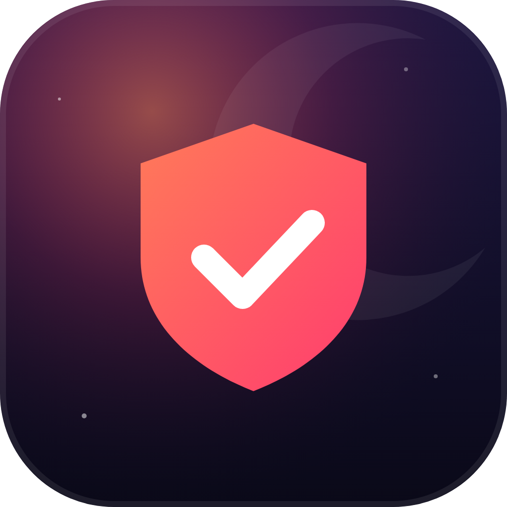

<p align="center"></p>

<h1 align="center">Avelune Shield</h1>
<p align="center"><b>Защита</b> · 7 скиллов · часть набора <a href="../../README.md">Avelune Labs</a></p>

Чтобы маркетинг не обернулся штрафом: маркировка рекламы, закон о рекламе и закон о русском языке (с 1 марта 2026 года), правила площадок, оферта и договоры, персональные данные по 152-ФЗ, антикризис и база знаний бизнеса.

**Не юридическое заключение.** Скиллы дают практический порядок действий со ссылками на статьи и датой проверки. Решения с высоким риском проверяет юрист.

## Установка

```text
/plugin marketplace add angelmaycrv/avelune-labs
/plugin install avelune-shield@avelune-labs
```

## Как пользоваться

Опишите задачу своими словами, Claude сам выберет подходящий скилл:

- «Проверь рекламу клиники на соответствие закону»
- «Что нужно сделать, чтобы разместить пост у блогера с маркировкой?»
- «Перепиши форму записи на сайте под требования 152-ФЗ»

Или вызовите скилл напрямую: `/avelune-shield:ad-law …`

## Скиллы

| Скилл | Что делает |
|-------|-----------|
| [`ad-law`](skills/ad-law/SKILL.md) | Проверка рекламы и маркетинговых текстов на соответствие закону о рекламе (38-ФЗ) и смежным законам: достоверность, «лучший» и «№1», сравнение с конкурентами, скидки и акции, розыгрыши, рассылки и звонки, дистанционная продажа, особые ниши (медицина, БАДы… |
| [`ad-marking`](skills/ad-marking/SKILL.md) | Маркировка интернет-рекламы в России: что считается рекламой, кто регистрирует креатив в ОРД и получает erid, как оформить пометку «Реклама» и данные рекламодателя, отчёты в ЕРИР, сбор 3%, реклама у блогеров и реестр блогеров, запрет рекламы на ресурсах… |
| [`contracts`](skills/contracts/SKILL.md) | Оферта и договоры для маркетинга и малого бизнеса: публичная оферта для сайта и онлайн-школы, договор с блогером, агентством, фрилансером, подрядчиком, самозанятым; права на тексты, дизайн и видео; маркировка рекламы и персональные данные в договоре; возвраты… |
| [`crisis`](skills/crisis/SKILL.md) | Антикризисные коммуникации: волна негатива, ошибка компании, утечка данных, отравление или травма клиента, скандал с сотрудником, фейк о компании, проверка или блокировка. |
| [`knowledge-base`](skills/knowledge-base/SKILL.md) | База знаний бизнеса для команды и ИИ-агентов: единый источник правды о компании, продуктах, ценах, правилах, тоне, решениях и шаблонах. |
| [`personal-data`](skills/personal-data/SKILL.md) | Персональные данные по 152-ФЗ для маркетинга и продаж: формы на сайте и в ботах, отдельное согласие с 1 сентября 2025 года, согласие на рассылки, политика обработки, уведомление Роскомнадзора, локализация, cookies и аналитика, передача подрядчикам, утечки и… |
| [`platform-rules`](skills/platform-rules/SKILL.md) | Правила площадок, чтобы не получить бан, страйк, отклонённую рекламу или блокировку карточки: VK, Telegram и Telegram Ads, Дзен, Rutube, Яндекс Директ, VK Реклама, маркетплейсы (с учётом закона о платформенной экономике с 1 октября 2026 года), карты. |

---

<sub>Avelune Labs · MIT · Факты в скиллах проверены на ноябрь 2026 года; правила площадок и законы меняются, сверяйте актуальное.</sub>
