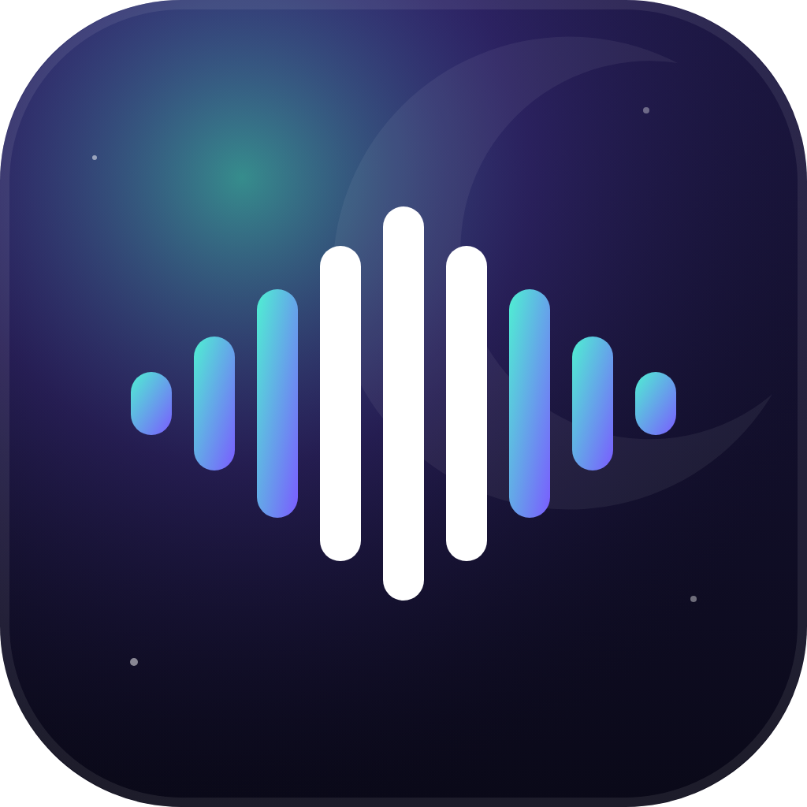

<p align="center"></p>

<h1 align="center">Avelune Sound Lab</h1>
<p align="center"><b>Звуковая лаборатория: исследования и разработка</b> · 10 скиллов · часть набора <a href="../../README.md">Avelune Labs</a></p>

Скиллы для тех, кто пишет аудиоэффекты, плагины и игры или разбирается в теории звука. Опора на архив конференции DAFx и классические работы JAES, IEEE и ICMC: канон из 68 работ, включая призёров DAFx 2018–2026, лежит в [`skills/dafx/references.md`](skills/dafx/references.md).

Для озвучки роликов, сведения и проверки звука ставьте [`avelune-sound`](../avelune-sound/README.md): там рабочие инструменты с проверкой цифрами.

| Скилл | Что делает |
|-------|-----------|
| [`dafx`](skills/dafx/SKILL.md) | Библиотека DAFx: подбор статей и алгоритмов под задачу. |
| [`dsp-effects`](skills/dsp-effects/SKILL.md) | Алгоритмы эффектов: задержки, модуляция, фильтры, динамика, время и высота, спектральная обработка. |
| [`virtual-analog`](skills/virtual-analog/SKILL.md) | Эмуляция аналога: ADAA, передискретизация, лестничные фильтры, WDF, лента и лампы. |
| [`audio-ml`](skills/audio-ml/SKILL.md) | Нейросети в звуке: моделирование усилителей, DDSP, генерация, разделение, права на данные. |
| [`plugin-dev`](skills/plugin-dev/SKILL.md) | Разработка аудиоплагинов: стек, реальное время, параметры, задержка, тесты, выпуск. |
| [`synthesis`](skills/synthesis/SKILL.md) | Синтез: вычитающий, FM, таблицы, аддитивный, гранулярный, физические модели. |
| [`reverb`](skills/reverb/SKILL.md) | Ревербераторы в коде (FDN, Dattorro, шиммер) и реверберация в миксе. |
| [`spatial-audio`](skills/spatial-audio/SKILL.md) | Стерео и моно, бинаурал, Ambisonics, Atmos. |
| [`game-audio`](skills/game-audio/SKILL.md) | Звук для игр: middleware, вариации, адаптивная музыка, громкость платформ. |
| [`real-sound`](skills/real-sound/SKILL.md) | Саундтрек ролика по методу earshot. Только вручную: `/avelune-sound-lab:real-sound`. |

## Установка

```text
/plugin install avelune-sound-lab@avelune-labs
```

---

<sub>Avelune Labs · MIT</sub>
