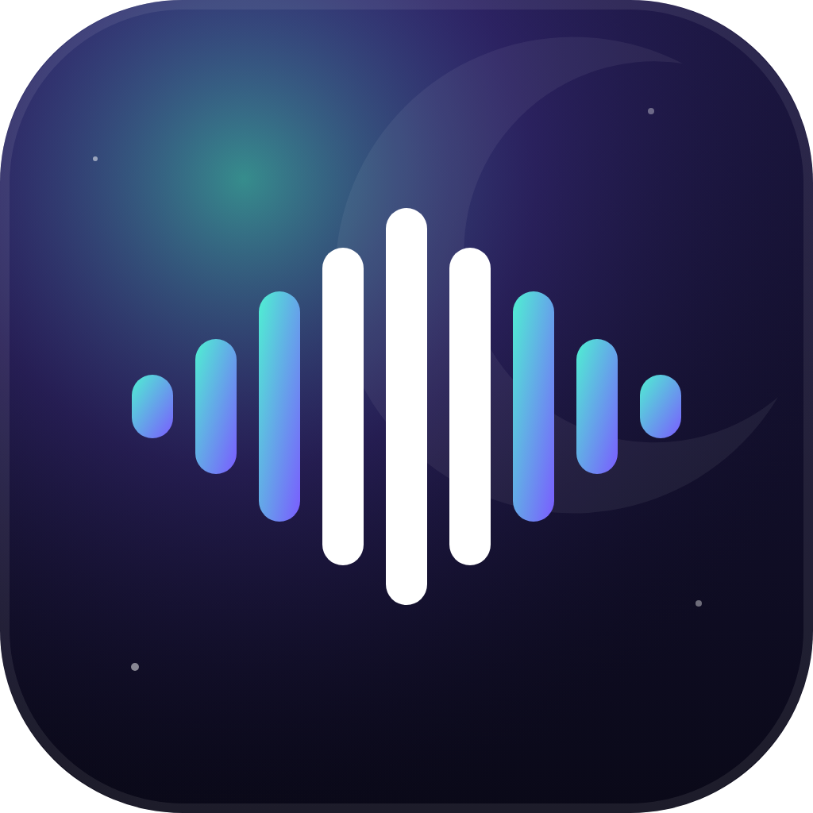

<p align="center"></p>

<h1 align="center">Avelune Sound</h1>
<p align="center"><b>Озвучка видео реальными звуками с проверкой цифрами</b> · 9 скиллов · часть набора <a href="../../README.md">Avelune Labs</a></p>

Claude не слышит. Поэтому плагин не учит его теории, а даёт ему инструменты и правила: где взять реальные записи, как поставить их на кадр, как свести и как проверить результат замером. Работа не сдаётся, пока замер не прошёл пороги площадки, а в отчёте всегда цифры (LUFS, true peak, рассинхрон в мс, голос над музыкой в LU) и 3–5 мест, которые стоит послушать человеку.

## Как это работает

```text
«озвучь ролик» → video-sound
  0. doctor.py        что установлено: ffmpeg, библиотека реальных звуков, earshot. Нет звуков: стоп и вопрос, а не синтез
  1. look / listen    что уже есть в ролике (голос, музыка, вшитый синтез), бриф и норма площадки
  1.5 замысел         concept.json: жанр, тон бренда, что зритель почувствует, главная точка, тишина, музыка, палитра
  2. моменты          из списка событий проекта, HyperFrames, записи экрана или по кадрам; каждое: обязательно / можно / молчит
  3. звуки            своя библиотека → автодокачка недостающего с Openverse (CC0/PDM/BY, CREDITS.md) → тишина
  4. сборка           Real SFX mix.py: на кадр, уровни по ролям, голос и музыка сохраняются
  5. ворота           verify (синхрон) · critique (баллы) · levels (баланс) · sound_check (норма площадки) · concept_check (замысел)
  6. отчёт            MP4 + дорожка эффектов + цифры + что послушать
```

## Скиллы

| Скилл | Что делает |
|-------|-----------|
| [`video-sound`](skills/video-sound/SKILL.md) | **Вход для любой озвучки видео.** Весь путь от проверки установки до отчёта с цифрами. |
| [`sound-setup`](skills/sound-setup/SKILL.md) | Установка и диагностика: `doctor.py`, подключение своей папки звуков, стартовая библиотека из Openverse, earshot. |
| [`sound-check`](skills/sound-check/SKILL.md) | Замер с вердиктом PASS/WARN/FAIL и готовыми исправлениями: громкость, true peak, телефон, моно, голос над музыкой, синхрон, один звук, A/B. |
| [`mix-master`](skills/mix-master/SKILL.md) | Голос + музыка + эффекты: обработка голоса, место под голос, даккинг, мастер под площадку, самопроверка. |
| [`sfx-design`](skills/sfx-design/SKILL.md) | Нужного звука нет: собрать его из слоёв реальных записей (атака, тело, саб, хвост) и проверить форму. |
| [`ui-sounds`](skills/ui-sounds/SKILL.md) | Звуки интерфейса и звуковой логотип: ноты в коде или записи, иерархия громкости, проверка. |
| [`real-sfx`](skills/real-sfx/SKILL.md) | Движок раскладки реальных звуков по кадрам (Clipwing Real SFX). Обычно вызывается из `video-sound`. |
| [`earshot`](skills/earshot/SKILL.md) | «Уши» агента: выбор по смыслу, реальная запись или синтез, таймлайн и синхрон, A/B. Нужен установленный earshot. |
| [`openverse`](skills/openverse/SKILL.md) | Поиск конкретного звука или музыки с открытой лицензией и CREDITS.md. |

Теория и разработка (DAFx, алгоритмы эффектов, виртуальный аналог, нейросети, аудиоплагины, синтез, ревербераторы, игры, пространство) переехали в отдельный плагин [`avelune-sound-lab`](../avelune-sound-lab/README.md), чтобы не мешать озвучке.

## Установка

```text
/plugin marketplace add angelmaycrv/avelune-labs
/plugin marketplace update avelune-labs
/plugin install avelune-sound@avelune-labs
```
Нужны Python 3.9+ и ffmpeg в PATH (Windows: `winget install Gyan.FFmpeg`, macOS: `brew install ffmpeg-full`). Потом попросите Claude «проверь установку звука» или запустите `python skills/sound-setup/scripts/doctor.py`: он скажет, чего не хватает, и даст команды. По желанию earshot (~1,1 ГБ моделей) добавляет выбор звука по смыслу и проверку «запись или синтез».

Настройки, индекс библиотеки и модели хранятся в `~/.avelune-sound/`, поэтому обновление плагина их не стирает.

## Примеры

- «Озвучь `promo.mp4` для Reels, звуки бери из `F:/sfx`»
- «Добавь звуки в анимацию интерфейса, своей библиотеки нет»
- «Сведи голос `vo.wav` с музыкой `track.mp3` под YouTube, голос тонет»
- «Проверь звук ролика перед отправкой клиенту»
- «Собери тяжёлый удар для появления логотипа»
- «Звуки для приложения доставки: нажатие, успех, ошибка, уведомление»

Лицензии и источники встроенных инструментов: [THIRD_PARTY_NOTICES.md](THIRD_PARTY_NOTICES.md).

---

<sub>Avelune Labs · MIT · Нормы громкости площадок проверены на ноябрь 2026 года; площадки меняют их без объявления, сверяйте актуальное.</sub>
